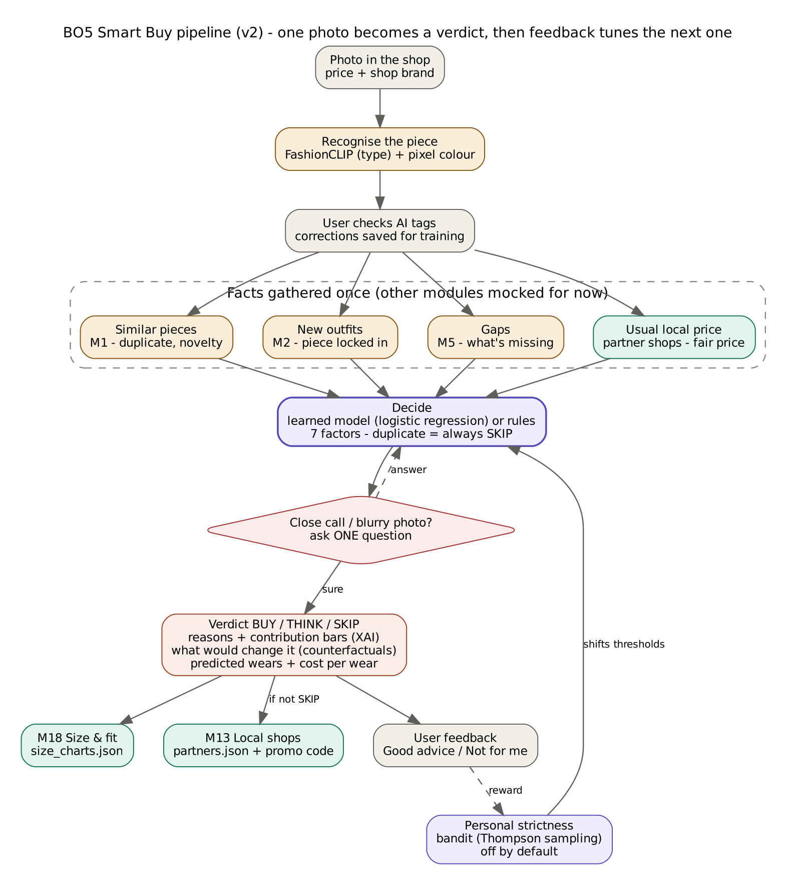

# BO5 · Smart Buy — "Should I buy it?"

**Owner:** Mohamed Aziz Chouaia · **Modules:** M6 Smart Buy, M13 Partner links, M18 Size fit
**Branch:** `feat/bo5-app` (backend + mobile) · `feat/bo5-extras` (backend only)
**Tests:** 203 passed (`cd backend && python -m pytest -q`)

---

## 1. What it does

The user is in a shop. They take a photo of a piece and type its price.
Smart Buy compares it with **their own wardrobe** and answers:

| Verdict | Meaning |
|---|---|
| **BUY** | Fills a gap, makes new outfits, fair price |
| **THINK** | Close call: wait, find it cheaper, or answer one question |
| **SKIP** | You already own something like it |

Every answer comes with: **why** (in plain words + a contribution bar per reason),
**what would change the answer** (e.g. "at 85 TND it becomes BUY"), **your size** at that brand,
**local Tunisian shops** selling it, and **cheaper look-alikes**.

---

## 2. Pipeline



```
Photo + price
  → 1. Vision: FashionCLIP reads type + colour + 512-d embedding            (M1, BO3)
  → 2. Wardrobe match: similar pieces already owned, new outfits possible   (M1 + M2, BO3/BO1-2)
  → 3. Gap + goals: does it fill a real gap?                                (M5 – mock)
  → 4. Decision: logistic regression → BUY/THINK/SKIP + safety rules
  → 5. Personal strictness: Thompson bandit learns from feedback
  → 6. Extras: what-if, XAI, size (M18), shops (M7/M13), look-alikes
  → 7. Explanation: Llama 3.1 8B writes 2 sentences from the facts only
  → 8. Memory + next actions for the orchestrator (BO8)
```

---

## 3. The agent (for the orchestrator, BO8)

| | |
|---|---|
| **LLM** | Llama 3.1 8B via Ollama — free, local, private. Only writes text + reads free text. **Our ML decides.** |
| **Memory** | Session (`session_id`, the pending question) + long term per user (past verdicts, feedback, wishlist, check-ins). One JSON per user in `ml/data/bo5/memory/` |
| **Identity** | `modules/m06_smartbuy/identity.py` — BO8 card format (name, rules, when_to_use, skills). `GET /m06/card`, `GET /m06/identity` |
| **Actions** | verdict · ask one question · explain · what-if · size · shop links · look-alikes · watch price · wear check-in · learn from feedback |
| **Tools** | M1 wardrobe/vision · M2 outfits · M7 local catalogue (6,531 products, 43 shops) · M13 links · M18 size · M5 / M8 (mock) |
| **Hand-off** | `next_actions` names the agent to call next: `stylist`, `localshop`, `smartbuy` |

### AI techniques
- **Prompt engineering:** facts-only prompt, strict JSON output, guardrails (no invented numbers, never contradicts the verdict), template fallback.
- **Embedding similarity (RAG-style):** FashionCLIP vectors find look-alikes in the wardrobe and in local shops; the LLM only rewrites retrieved facts.
- **ML:** logistic regression (82 % CV, **synthetic data**), Thompson-sampling bandit for personal strictness.
- **No fine-tuning.**

---

## 4. New features (this push)

### ❤ Wishlist price watch
On THINK → "Watch the price for me". Target = 15 % under the seen price.
Smart Buy checks local shop prices and alerts when one is at or under the target, then offers to re-judge at the new price. No duplicate alerts.

### 🏷 Cheaper look-alikes
For BUY / THINK: same type, **≥ 15 % cheaper**, same colour first then close colours, one per shop.

### 📅 Wear check-in → real labels
After "I bought it", ~30 days later: *"How many times did you wear it?"*
Answer in EN / FR / Tounsi ("twice", "jamais", "barcha") — rules first, Llama only if unclear.
The answer becomes a **real label**: 0 or regret → SKIP, 1–2 → THINK, 3+ → BUY.
`GET /m06/labels` returns all labels + **how often Smart Buy was right** (honest KPI).
This fixes our main weak point: the model was trained on synthetic data.

---

## 5. API

| Method | Endpoint | What |
|---|---|---|
| POST | `/m06/verdict` | Judge a piece (or answer the agent's question with no new photo) |
| POST | `/m06/analyze` | Photo → type + colour (to confirm) |
| POST | `/m06/feedback` | Bought? Good advice? |
| POST | `/m06/shopping-list` | What the wardrobe really misses |
| GET | `/m06/history/{user}` | Past verdicts |
| DELETE | `/m06/memory/{user}` | Forget the user (privacy) |
| GET | `/m06/card` · `/m06/identity` · `/m06/meta` | Agent card · identity · data for the screen |
| POST | `/m06/wishlist` | Add to wishlist |
| GET / DELETE | `/m06/wishlist/{user}` · `/m06/wishlist/{user}/{id}` | List / remove |
| POST | `/m06/wishlist/{user}/check` | Price alerts |
| GET | `/m06/alternatives` | Cheaper look-alikes |
| GET / POST | `/m06/checkin/{user}` · `/m06/checkin` | Check-ins due · answer one |
| GET | `/m06/labels` | Real labels + accuracy |
| POST | `/m13/click` | Shop link opened (KPI, logged in M7) |
| POST | `/m18/parse-fit` | "I wear M at Zara, tight on shoulders" → size facts |

Full schemas: `http://localhost:8000/docs`

---

## 6. Run it

```bash
# 1. backend (one server for all modules)
cd backend
pip install -r requirements.txt pydantic-settings pytest-asyncio
python -m uvicorn api.main:app --reload --port 8000

# 2. optional: AI explanations
ollama pull llama3.1:8b        # once; Ollama runs in the background

# 3. app
cd mobile
flutter pub get
flutter run -d chrome          # or an Android emulator (API = 10.0.2.2:8000)
```
Real phone: `flutter run --dart-define=API_URL=http://<PC-IP>:8000`
Debug builds ask the wear check-in right away (no 30-day wait) for demos.

---

## 7. Files

```
backend/modules/m06_smartbuy/
  agent.py        the agent: run, judge, memory, next actions
  extras.py       wishlist, look-alikes, wear check-in, real labels   (new)
  explainer.py    Llama explanation + guardrails + template fallback
  identity.py     agent card (BO8 format)
  memory.py       session + long-term memory
  clients/real.py real teammates' modules, mock fallback per call
  pipeline/       decide, score, uncertainty, what-if, XAI
  config.yaml     real: [m1, m2, m7] · explainer: own · shops_source: auto
backend/modules/m13_partner_links/   shop links from M7 + click log
backend/modules/m18_size_fit/        size charts + text_fit (rules + LLM)
mobile/lib/features/bo5_smart_buy/   data / logic (Riverpod) / ui
```

---

## 8. Integration notes ⚠️

- **Shared files touched** (design kit): `mobile/lib/app/theme.dart`, `mobile/lib/app/router.dart` (`/design` gallery), `mobile/pubspec.yaml` (DM fonts), `mobile/lib/core/widgets/dm_widgets.dart`, `mobile/assets/fonts/`.
- `feat/bo5-app` contains a merge of `BO6/local_catalogue` (the screen uses Kenza's `dressme_design.dart`).
- `backend/api/main.py`: CORS for `localhost` (web dev).
- Each teammate module is called **for real with a mock fallback**: if your module changes, BO5 keeps working. Switch with `real:` in `config.yaml`.
- M2 needs 1024-d vectors, M1 gives 512-d → M2 similarity stays on mock until aligned.
- Known issue (not BO5): `mobile/test/bo6_local_market_test.dart` misses the `offset` parameter.

## 9. Limits & next steps
- 82 % accuracy is on synthetic data → wear check-ins collect real labels to retrain.
- M5 (goals) and M8 (assistant) are still mocked.
- Next: price-sensitivity learning, budget coach, cost-per-wear tracking, push notifications for price alerts.
