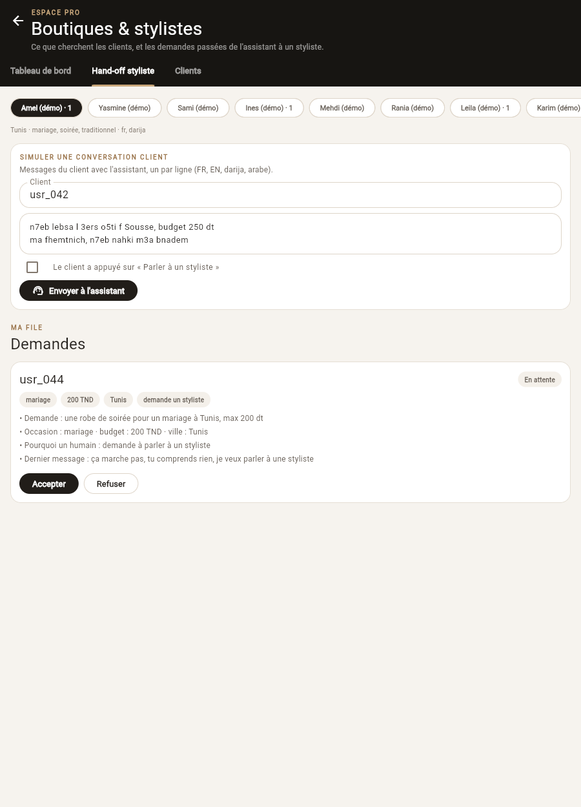
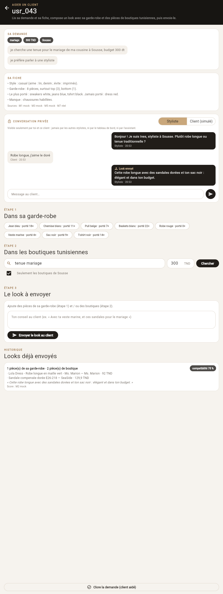
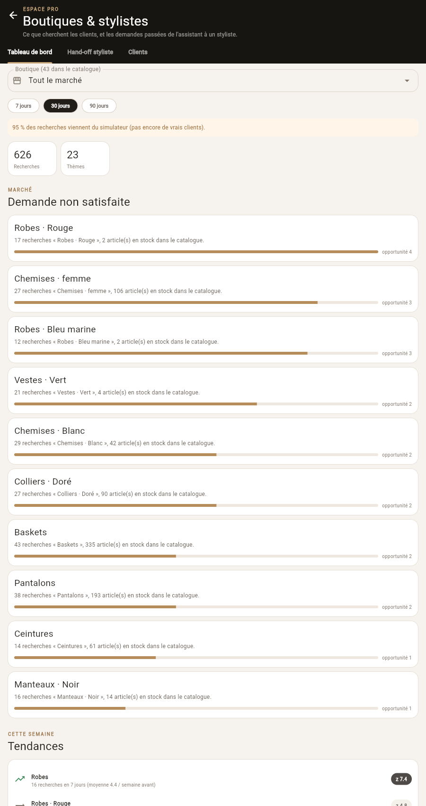

# DressMe — Module M14 « Stylist / boutique mode »

**Rapport technique court · BO6 Marché tunisien · ESPRIT 2026**
Le côté professionnel de DressMe : les boutiques tunisiennes et les stylistes humains.

*Version du 24/10/2026 (codes fidélité, défis de marques locales, tableau de bord plus rapide). Les données clients et le trafic sont simulés (aucun vrai utilisateur avant la
démo) ; la recherche dans les boutiques, elle, est réelle (catalogue M7 : 43 boutiques, 6 375 produits).*

---

## 1. Objectif

M14 répond à deux besoins de la persona *Amel*, propriétaire de boutique ou styliste à Tunis :

1. **Savoir ce que les clients cherchent sans le trouver**, pour adapter son stock et ses prix
   (« 27 recherches de colliers dorés ce mois-ci, 0 chez vous »).
2. **Prendre le relais de l'assistant** quand il ne suffit plus : le client demande un humain, il est
   frustré, ou l'occasion est importante (mariage, fiançailles…). La styliste reçoit la demande résumée,
   l'accepte, échange en privé avec le client et lui envoie un look.

Dans le découpage du projet, M14 couvre : comptes professionnels, profils clients, tableau de bord de la
demande et hand-off. Il est utilisé par BO4 (validation du profil), BO5 (vendeur en magasin), BO6
(tableau de bord), BO7 (looks partagés) et BO8 (hand-off).

## 2. Place dans l'architecture

Le guide de l'équipe impose **un agent par BO**. M14 n'est donc pas un agent : c'est une **compétence de
l'agent BO6 `localshop`** (même choix que dans la branche de l'orchestrateur). Il n'a pas de `tool.py` ;
l'application appelle ses routes HTTP, et l'agent `localshop` les appellera depuis le chat.

```
App (Espace pro BO6)  ──►  /m14/*  ──►  service.py ─┬─ store.py      JSON : pros, liens, demandes, looks, conversations
                                                     ├─ dashboard/    thèmes · demande non satisfaite · prix · tendances
                                                     ├─ handoff/      escalade · choix du styliste · résumé
                                                     └─ clients.py    M7 réel · M1 M2 M3 M5 M6 M10 (mock tant que non fusionnés)
```

| Élément du guide | Dans M14 |
|---|---|
| Contrat typé | `contract.py` (Pydantic) + `mock.py` aux mêmes formes, testé |
| Fiche d'identité | `identity.py` : compétence `boutique` de `localshop` (`GET /m14/identity`) |
| Clients réels / mock | `clients.py` : `real: [m7]` dans `config.yaml` ; chaque réponse indique sa source (`sources`) |
| Aucune constante cachée | seuils, poids et plages dans `config.yaml` |
| Mémoire | `store.py`, un fichier JSON par collection dans `ml/data/bo6/m14/` (jamais dans git) |
| LLM | Qwen 2.5 7B local (Ollama), partagé avec M7 : il lit et rédige, le code décide (§6) |
| Tests + README | 51 tests, README à jour |

## 3. Fonctionnalités

| | Fonction | Ce que fait M14 |
|---|---|---|
| F1 | Comptes pro | Styliste ou boutique ; une boutique = une boutique du catalogue M7, un seul compte par boutique |
| F2 | Clients et consentement | Invitation → acceptation par le client ; il peut retirer l'accès à tout moment. Fiche en 5 lignes (garde-robe M1, port M3, style M5, recherches dans les boutiques) |
| F2b | **Conversation privée** | Messages entre **une** styliste et **un** client, voir §5 |
| F3 | Relecture du profil (BO4) | Les corrections de la styliste partent vers M5 ; M14 mesure l'accord entre M5 et les stylistes |
| F4 | Looks (BO7) | Pièces de sa garde-robe + pièces de boutiques tunisiennes, note de compatibilité M2, total à acheter en TND |
| F5 | Vendeur en magasin (BO5) | Verdict Smart Buy (M6) sur la garde-robe du client, seulement pour les pièces de la boutique |
| F6 | Tableau de bord (BO6) | Voir §4 |
| F7 | Hand-off (BO8) | Escalade → choix de la styliste → résumé → file : accepter / refuser (styliste suivante) / clore |
| F8 | **Codes fidélité** (idée Backup 2) | La boutique saisit son code dans son compte : code, remise (1 à 70 %), date de fin et conditions (« dès 100 TND »). M7 l'affiche sur toutes ses pièces ; `GET /m14/loyalty` donne les codes valides à M13 (BO5) pour ses liens d'achat |
| F9 | **Défis de marques locales** (idée Backup 5) | La boutique sponsorise un défi de 7 jours publié sur M15 (BO7), avec la règle M15 `local_brand` et 6 de ses pièces proposées. **Un seul défi actif par boutique** (sinon 409) ; « End challenge » le termine avant la fin |

**Codes fidélité et défis (24/10).** Un code ou un défi appartient au **compte boutique** : on ne peut pas
en créer pour une boutique sans compte, et un styliste n'en a pas (refus 422). Dans l'app, l'onglet
*Clients* permet de choisir n'importe laquelle des 43 boutiques du catalogue ; son compte est ouvert à la
première utilisation. Le code est vérifié (3 à 24 lettres, chiffres ou « - ») et n'est plus montré après
sa date de fin. Un défi dure `duration_days` jours : il est *actif* jusqu'à son dernier jour (`ends_on`),
puis *terminé* ; la boutique peut aussi le terminer avant (`POST /m14/challenges/{id}/end`). Un seul défi
actif évite de partager les participants entre deux défis de la même boutique. M15 est **simulé** tant que
la branche du BO7 n'est pas fusionnée (identifiant `sim_chl_…`, `sources.m15 = "mock"`) ; le format envoyé
est déjà celui de `POST /m15/challenges/create`.

**Côté client**, le défi s'affiche dans l'écran *Challenges* du BO7 : titre, description, « Sponsored by
Manuella », règles, bouton « Join · 7 days », progression, classement. Les pièces suggérées n'existent pas
dans le format de M15 : le BO7 les lit à `GET /m14/challenges/{id}` (même identifiant) pour une section
« Pieces from Manuella » avec un lien vers la boutique (détails dans le guide d'intégration).

**Le parcours de la styliste** : une demande arrive dans sa file → *Accepter* ouvre la page **« Aider un
client »** : sa demande et sa conversation avec l'assistant, sa fiche, la conversation privée, puis
étape 1 « dans sa garde-robe », étape 2 « dans les boutiques tunisiennes » (vraie recherche M7, budget et
ville de la demande pré-remplis), étape 3 « le look à envoyer », et enfin *Clore la demande*. Un client ne
peut avoir qu'une demande ouverte à la fois (pas de doublons).

<p align="center"> </p>
<p align="center"><em>À gauche : la file d'Amel (demande escaladée, résumé). À droite : la page « Aider un client »
(conversation privée, garde-robe, recherche locale, look envoyé à 221,9 TND).</em></p>

## 4. Le tableau de bord de la demande

Source : le journal des recherches et des clics de M7, plus un **trafic simulé** (`simulate/traffic.py`) :
300 utilisateurs tunisiens sur 12 semaines (ville, genre, budget), requêtes en français, anglais, darija
et arabe, toutes passées par la **vraie** recherche M7. Deux signaux connus sont injectés pour vérifier
que le tableau de bord les retrouve : une vague de « sandales dorées pour mariage » dans le Sahel les deux
dernières semaines, et une demande régulière de costumes homme.

| Bloc | Méthode |
|---|---|
| **Thèmes** | Chaque recherche → la phrase anglaise de M7 pour FashionCLIP (la darija est déjà traduite) → vecteur texte FashionCLIP → KMeans pondéré, nombre de thèmes choisi par silhouette (12 à 30). Nom du thème = type, couleur et genre les plus fréquents (des faits, pas un texte de LLM). |
| **Réponse exacte** | Une recherche est satisfaite si un résultat affiché a le type et la couleur demandés avec un bon score. Si M7 a dû relâcher la couleur (« pas de sandales dorées : voici d'autres sandales »), elle compte comme **non satisfaite**. |
| **Demande non satisfaite** | Seulement dans les catégories que la boutique vend. Opportunité = recherches × (1 − couverture) ; couverture = stock correspondant (3 pièces = complet) et meilleure ressemblance FashionCLIP entre le thème et les photos de la boutique. |
| **Prix** | Budgets demandés (quartiles) comparés aux prix de la boutique ; part des budgets servis. |
| **Tendances** | 7 derniers jours comparés aux 8 semaines précédentes (z-score). |
| **Entonnoir** | Pièces affichées, ouvertes, visites du site, rang de la boutique. |

**Temps de réponse (24/10).** Le calcul des thèmes prenait l'essentiel du temps (environ 13 s sur un
processeur : ~3 s pour les vecteurs FashionCLIP des ~300 requêtes distinctes, ~10 s pour KMeans essayé de
12 à 30 thèmes). Désormais, le vecteur d'une requête est calculé une seule fois, et les thèmes sont gardés
`cache_minutes` (10 min, `config.yaml`) : une requête apparue depuis rejoint le thème dont le centre est le
plus proche. Passé ce délai, les anciens thèmes sont encore affichés pendant qu'un nouveau calcul tourne en
arrière-plan. Résultat : **0,5 s au lieu de 13 s**, sauf le tout premier affichage après le démarrage du
serveur. Les chiffres (recherches, prix, entonnoir) sont toujours recalculés ; seul le regroupement en
thèmes peut avoir jusqu'à 10 minutes. La ligne `method.themes` de la réponse dit l'âge des thèmes.

**Résultats sur le mois simulé (30 derniers jours)** : 626 recherches (95 % simulées, affiché en
bandeau), 23 thèmes visibles (k = 26, silhouette 0,26), 14 groupes trop petits masqués, 3 recherches non
comprises.

- Le signal injecté est retrouvé : **« Sandales · Doré »** est le premier thème (94 recherches, Sousse,
  Monastir, Mahdia, budget médian 70 TND), avec 34 recherches en 7 jours contre 11,6 par semaine avant
  (× 2,9).
- Pour **Manuella** (chaussures et sacs, 7e boutique par visites) : « 27 recherches « Colliers · Doré »,
  0 chez vous (90 dans tout le catalogue) », « 15 recherches « Chaussures · Rouge », 0 chez vous (3 dans
  tout le catalogue) » ; ses sandales (médiane 59,5 TND) servent 100 % des budgets demandés (médiane 70 TND).

<p align="center"></p>

## 5. Le hand-off et la conversation privée

**Faut-il passer la main ?** Des règles en français, anglais, darija et arabe détectent : la demande d'un
humain (« je veux parler à une styliste », « n7eb nahki m3a bnadem »), la frustration (« ça marche pas »,
« ma fhemtnich »), une occasion importante (mariage, 3ers, khotba…), une faible confiance de l'assistant,
une longue conversation, une demande répétée. Les signaux se combinent (OU probabiliste) ; demander un
humain déclenche toujours le hand-off. Une demande simple comme « robe noire » reste à l'assistant, qui
répond seul avec M7.

**Quelle styliste ?** Score pondéré : spécialités citées dans la conversation, même ville ou même
gouvernorat, langue, charge de travail, et proximité de style quand M5 fournira les vecteurs. Exemple :
« tenue pour le mariage de ma cousine à Sousse, budget 300 dt » → Ines (mariage, Sousse) ; « costume homme
pour un mariage à Tunis » → Sami (costume, homme, mariage, Tunis). La styliste reçoit un résumé de 5 lignes
construit uniquement à partir des faits de la conversation.

**Conversation privée.** Seuls la styliste et le client du lien peuvent la lire et y écrire ; tout autre
compte reçoit un refus (403). La styliste n'y a accès que tant que le client lui donne accès ; si le client
retire l'accès, elle ne peut plus ni lire ni écrire, et la conversation est fermée. Le client peut
**effacer** la conversation (droit à l'oubli). Elle n'est jamais utilisée par le tableau de bord ni par
l'assistant. Les looks envoyés y apparaissent avec le message de la styliste.

**Confidentialité en général.** Le tableau de bord ne montre que des agrégats, sans identifiant de client,
et masque les groupes de moins de 10 recherches. Accepter une demande donne à la styliste l'accès à la
fiche du client (c'est lui qui a demandé de l'aide), accès révocable comme une invitation. À mentionner
dans la spécification : loi tunisienne 2004-63 sur la protection des données personnelles.

## 6. Le LLM : Qwen 2.5 7B en local (partagé avec M7)

L'agent BO6 utilise **un seul LLM**, pour M7 et M14 : **Qwen 2.5 7B**, exécuté **sur la machine** avec
Ollama. Il est gratuit, sans clé d'API, les conversations des clients ne sortent pas de la machine, et il est
bon en français et en arabe, ce qui aide pour la darija. **Il lit et rédige ; il ne choisit jamais un
produit, un prix, un score ou une styliste.** Chacune de ses sorties est vérifiée par le code, et s'il est
éteint ou trop lent, les règles répondent comme avant.

**Langue (23/10)** : l'Espace pro de l'app est en anglais, donc les textes que M14 renvoie (résumé, raisons
du choix de la styliste, fiche client, messages du tableau de bord, conseils) sont écrits en anglais. Les
clients écrivent toujours en français, anglais, darija ou arabe : la compréhension ne change pas. Les codes
internes (occasion `mariage`, spécialités des stylistes) restent tels quels, car ils servent à l'appariement ;
l'app les affiche en anglais (`bo6_words.dart`).

| Usage dans M14 | Ce que fait le LLM | Ce que le code vérifie | Temps (CPU) |
|---|---|---|---|
| **Résumé pour la styliste** | Une phrase claire de ce que veut le client, même depuis la darija | ≤ 260 caractères, aucun chiffre que le client n'a pas écrit ; les lignes de faits (occasion, budget, ville, raison) restent calculées | 7-10 s |
| **Escalade** (conversations longues que les règles n'escaladent pas) | Demande un humain ? frustré ? occasion importante ? | Le LLM doit **citer mot pour mot** les paroles du client (*grounding*) ; une citation absente de la conversation est ignorée ; il peut ajouter un signal, jamais en retirer | 9-14 s |
| **Conseils pour la boutique** (`GET /m14/dashboard/insights`, bouton « Generate tips ») | 2-3 conseils à partir des chiffres du tableau de bord | Tout chiffre d'un conseil doit exister dans les chiffres, sinon le conseil est retiré ; chaque ligne de chiffres porte un **verdict calculé par le code** (manque, peu de pièces, bien fourni ; prix bien placés ou trop chers) que le LLM doit suivre | 30-50 s |

Exemples réels avec Qwen 2.5 7B :
- Résumé : « Le client souhaite un costume pour un mariage à Tunis et demande des conseils. »
- Escalade : « sma3ni chkoun ynajem y3awenni / 7ajti b chkoun ya3ref lmoda » → escalade (le LLM cite
  « chkoun ynajem y3awenni ») ; « je cherche une robe rouge pour samedi / merci c'est parfait » → pas
  d'escalade.
- Conseils pour Manuella (23/10, en anglais) : « Necklaces: consider adding at least one necklace to your
  inventory to meet customer demand. » ; « Red shoes: stock at least one pair of red shoes to fill the
  current gap in your offerings. » ; « Sneakers: highlight your existing stock of sneakers, as they are well
  stocked and likely to appeal to many customers. » (verdicts du code : 0 collier, 0 chaussure rouge,
  34 baskets.)

Deux erreurs observées pendant la mise au point ont conduit à ces garde-fous :
- avec le modèle 3B, une conversation banale était prise pour une demande d'humain (d'où la citation
  obligatoire) ;
- un conseil disait de « revoir les prix » alors que la boutique était déjà sous le budget des clients
  (d'où la comparaison faite par le code) ;
- un conseil disait « seulement 335 pièces » pour un type très bien fourni, et un autre lisait « 100 % des
  budgets servis » comme « prix trop chers » (d'où un verdict écrit par le code sur chaque ligne de
  chiffres).

Les chiffres sont vérifiés automatiquement ; le raisonnement, lui, ne peut pas l'être entièrement, et c'est
pour cela que les conseils restent des suggestions pour la propriétaire.

## 7. Tests

51 tests automatiques, environ 70 secondes, sur un catalogue de 8 produits avec un faux encodeur et un faux
LLM (sans modèle, sans internet, sans Ollama) et des dossiers temporaires (les vraies données ne sont jamais touchées).

| Fichier | Tests | Ce qui est vérifié |
|---|---|---|
| `test_mock.py` | 8 | Chaque réponse du mock respecte le contrat |
| `test_pros_clients.py` | 8 | Comptes boutique, consentement et retrait, fiche, accord M5/stylistes, looks, vendeur en magasin, **conversation privée** (accès, look dans la conversation, retrait, effacement) |
| `test_dashboard.py` | 7 | Le simulateur écrit son propre journal ; le tableau de bord retrouve le signal injecté ; boutique (message, entonnoir, prix) ; erreurs 404 / 403 ; journal vide ; **thèmes gardés puis recalculés en arrière-plan ; nouvelle requête rattachée au thème le plus proche** |
| `test_handoff.py` | 14 | Escalade FR / EN / darija, cas sans escalade, choix de la styliste et résumé, cycle accepter / refuser / clore, une seule demande ouverte (un nouveau message s'y ajoute), occasion principale d'un message |
| `test_llm.py` | 6 | Avec un faux LLM : phrase du résumé utilisée, phrase avec un chiffre inventé rejetée, escalade par le LLM, citation inventée ignorée, conseils gardés seulement avec des chiffres réels, conseils par règles sans LLM |
| `test_local_brand.py` | 8 | Codes de démo lus par M7, code saisi / retiré / expiré, code refusé pour un styliste ou mal écrit ; défi simulé, défi publié sur un faux M15 (chemin, règles, titre), **un seul défi actif puis « End », défi terminé après son dernier jour** |

```bash
cd backend && pytest modules/m14_stylist_mode
```

## 8. Limites et suite

- **Données simulées.** Clients fictifs et trafic simulé : les chiffres du tableau de bord valident la
  méthode, pas le marché. Les garde-robes, profils, notes de compatibilité et verdicts viennent des mocks
  de M1, M5, M2 et M6 ; ils deviendront réels en ajoutant ces modules à `real:` une fois leurs branches
  fusionnées, sans changer le code.
- **Tendance à la limite.** La vague de sandales dorées est nette (× 2,9) mais son z-score (1,99) reste
  juste sous le seuil de 2 : la vague dure deux semaines et la première gonfle déjà la référence. Exclure
  la semaine précédente de la référence, ou utiliser un test de Poisson, la ferait ressortir.
- **Défis et M15.** M15 n'a pas encore de route pour clore un défi : « End challenge » le termine côté
  BO6 (il n'est plus proposé), et M15 le clôt à la fin de sa durée. À l'intégration, le BO7 peut ajouter
  `POST /m15/challenges/{id}/end`, que M14 appellera (voir le guide).
- **Pas encore relié au chat.** L'agent `localshop` doit proposer « Parler à un styliste » (next_action
  vers le hand-off) pour que le parcours parte aussi de l'assistant.
- **LLM sur processeur.** Sans carte graphique, Qwen 2.5 7B met 7 à 30 s par réponse : il n'est appelé
  que lorsque les règles échouent, et les conseils sont générés à la demande. Le modèle 3B est deux fois
  plus rapide, pour une compréhension comparable sur notre petit jeu de test (voir le rapport M7).
- **Sécurité.** L'identité de l'auteur d'un message est déclarée par l'appelant : la vraie confidentialité
  demande l'authentification de la passerelle API (JWT), prévue dans le projet.
- **À faire ensuite.** Prévision de la demande (calendrier tunisien : Ramadan, Aïd, mariages d'été, soldes),
  segments de clientèle, classifieur d'escalade entraîné, écran côté client pour recevoir les looks.

## 9. Tester dans l'application

```bash
cd backend
python -m modules.m14_stylist_mode.simulate.pros       # stylistes, boutiques et clients de démo (--reset)
python -m modules.m14_stylist_mode.simulate.traffic    # 12 semaines de recherches via M7 (~2 min)
ollama pull qwen2.5:7b                                  # LLM (optionnel : sans lui, les règles répondent)
uvicorn api.main:app --port 8000
cd ../mobile && python tool/serve_app.py --api http://127.0.0.1:8000   # http://localhost:8090/#/bo6_boutique
```
