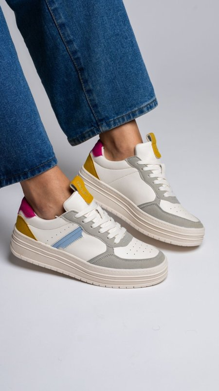
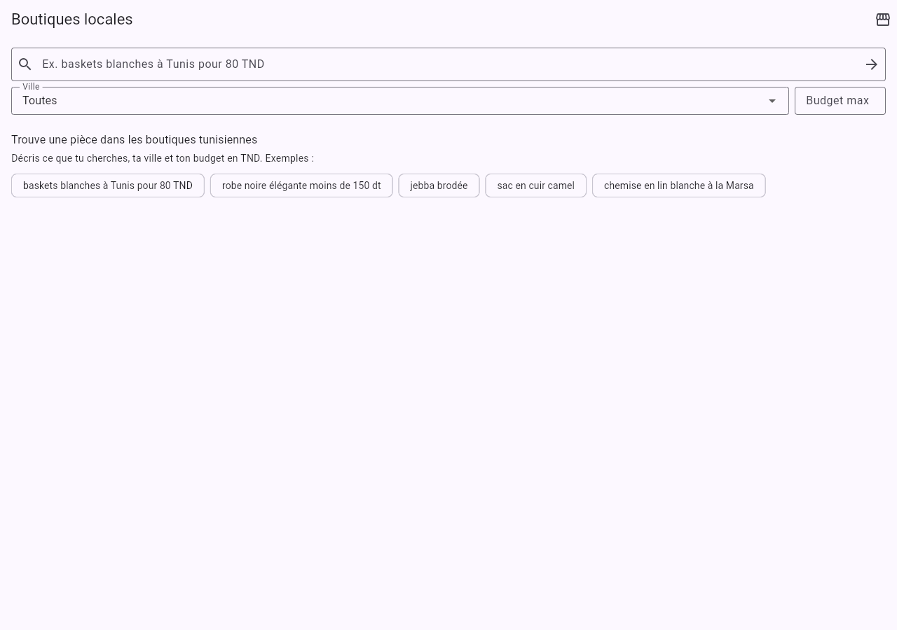
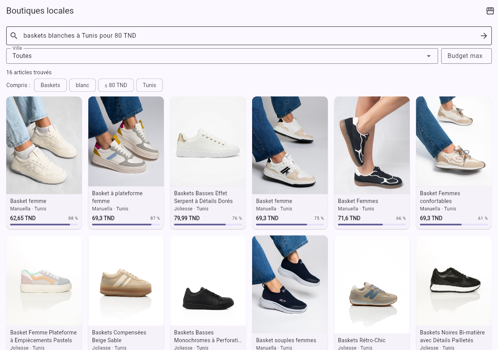
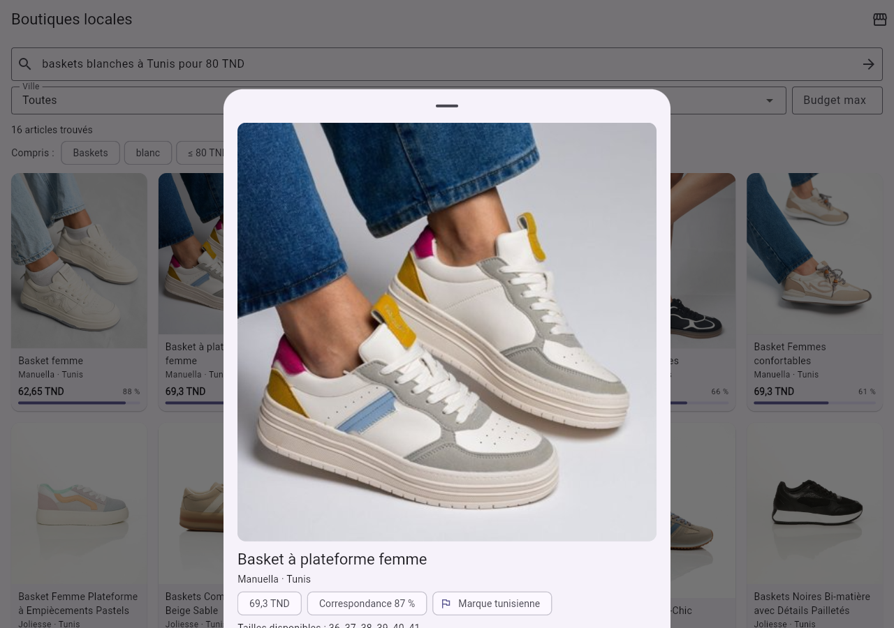
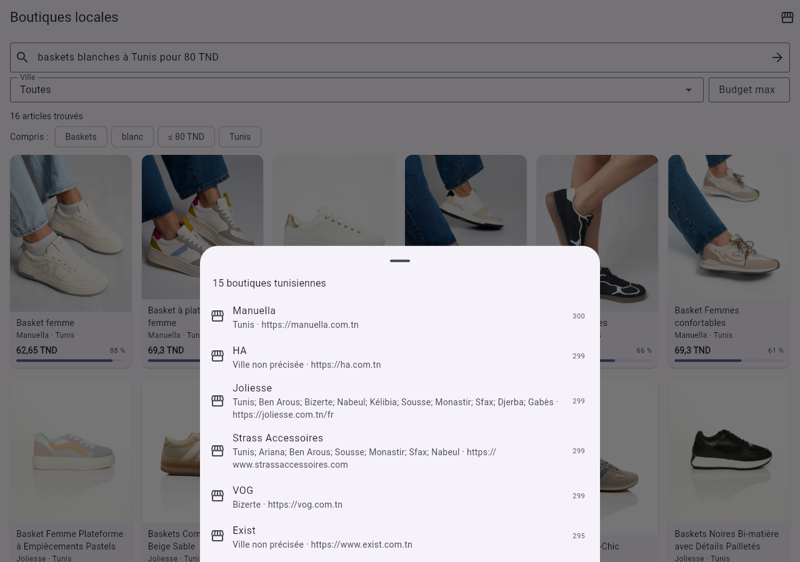

# DressMe — Module M7 « Catalogue local »

**Rapport technique · BO6 Marché tunisien · ESPRIT 2026**
Collecte des données (scraping), nettoyage, moteur de recherche de vêtements dans les boutiques tunisiennes,
et évaluation.

*Mis à jour le 22/10/2026 : LLM Qwen 2.5 7B (§5.13, §6.6). Le 16/10/2026 : 43 boutiques, 6 375 produits. Première version le 14/10/2026 (15 boutiques,
2 471 produits).*

---

## Sommaire

1. [Contexte et objectif](#1-contexte-et-objectif)
2. [Vue d'ensemble](#2-vue-densemble)
3. [Collecte des données : le scraping](#3-collecte-des-données--le-scraping)
4. [Nettoyage des données](#4-nettoyage-des-données)
5. [Le module M7](#5-le-module-m7)
6. [Évaluation](#6-évaluation)
7. [Comment tester le module](#7-comment-tester-le-module)
8. [Limites et pistes d'amélioration](#8-limites-et-pistes-damélioration)
9. [Annexe : fichiers du module](#9-annexe--fichiers-du-module)

---

## 1. Contexte et objectif

DressMe est un assistant de mode personnel. Le module **M7 « Catalogue local »** répond à un besoin
précis du marché tunisien : une utilisatrice cherche par exemple *des baskets blanches à Tunis pour un
budget de 80 TND*. Aujourd'hui elle doit parcourir des dizaines de pages Instagram et de sites. M7 lui
propose directement des articles de boutiques tunisiennes adaptés à sa demande, à son budget et à sa ville,
qu'elle écrive en français, en anglais, en darija ou en arabe.

Exemple de résultat obtenu par le module :

> **Manuella · Tunis · Basket à plateforme femme · 69,3 TND · lien vers la fiche produit**

**Place dans le projet.** D'après le document de répartition des tâches (*Task Split*), M7 est un
**module partagé** : il est construit une seule fois par BO6 et appelé par d'autres BO (BO1, BO2, BO3,
BO5, BO7, BO8, BO9). Il doit donc exposer une API stable. Le document d'architecture
(*DressMe_MultiAgent_Pipeline.pdf*, section 7 « Local shop agent ») fixe :

| Élément | Exigence de l'architecture | Ce qui a été réalisé |
|---|---|---|
| Base de connaissances | CSV/JSON de boutiques et de pièces, sans scraping en direct | CSV nettoyé de 6 375 produits (43 boutiques) + index d'images, dans `ml/data/shops/` |
| Recherche | Embeddings + BM25 (hybride) | FashionCLIP (image + texte) + BM25 |
| Filtres | Prix (TND), ville, catégorie, style | Prix, ville/gouvernorat, catégorie, **couleur**, **genre**, stock, vecteur de style |
| Intégration | Outil appelable par l'orchestrateur (LangGraph) | Outil `localshop` + API REST `/m07/*` + écran BO6 Flutter |
| Entrée / sortie | `query, gap, style_vector` → `shop, area, item, price_tnd, match` | Mêmes champs, enrichis (liens, photo, genre, raisons, pagination) |

La demande complémentaire était d'utiliser **FashionCLIP en local en Python**, ce qui a été fait (§5.2).
Ce choix a ensuite été comparé à deux modèles plus récents sur notre catalogue (§5.12), et le module a été
**évalué** sur 72 requêtes écrites à la main (§6).

---

## 2. Vue d'ensemble

Le travail se fait en deux temps : une préparation des données **hors ligne** (à relancer de temps en
temps pour mettre à jour prix et stocks), puis une recherche **en ligne** très rapide.

```
HORS LIGNE (préparation)                     EN LIGNE (chaque recherche, ~40 ms)

 Sites des boutiques (43)                     « baskets blanches à Tunis 80 TND »
    │ 1. scraper/run.py                                 │
    ▼                                                   ▼
 local_catalogue.csv + images/ (6 760)        parse    -> baskets, blanc, Tunis, ≤ 80 TND
    │ 2. scraper/clean.py                               │    (darija et arabe traduits avant)
    ▼                                                   ▼
 local_catalogue_clean.csv (6 375)            retrieve -> FashionCLIP + BM25
    │ 3. pipeline/ingest.py                             │
    ▼                                                   ▼
 index/ (1 vecteur par photo)  ─────────────► filter   -> prix, ville, type, couleur, genre
    │ 4. pipeline/attributes.py                         │
    ▼                                                   ▼
 genre estimé d'après la photo                rerank   -> score, style, diversité, raisons
```

Toutes les données (CSV, photos, index, rapports) sont dans `ml/data/shops/` et sont **versionnées dans
git** sur la branche `BO6/local_catalogue` (≈ 340 Mo, dont 327 Mo de photos), pour que l'équipe les
récupère avec un simple `git pull`. Le README du projet prévoit DVC pour les données : la bascule vers DVC
ou Git LFS reste possible si le dépôt devient trop lourd (§8).

### 2.1 Input → modèle → output

Chaque étape reçoit une entrée (*input*), la transforme avec un modèle ou une méthode, et produit une
sortie (*output*) qui devient l'entrée de l'étape suivante.

| Étape | Input | Modèle / méthode | Output |
|---|---|---|---|
| 1. Scraping | Données d'une boutique (ex. JSON Shopify de Manuella) | Adaptateur de plateforme + règles de normalisation | 1 ligne CSV brute + 1 photo JPEG |
| 2. Nettoyage | Ligne brute | Règles, empreinte d'image *dHash*, vérification HTTP | 1 ligne propre (28 colonnes) |
| 3. Indexation | Photo JPEG (800 px) | **FashionCLIP — encodeur d'image** (réseau de neurones pré-entraîné) | Vecteur de 512 nombres |
| 4. Genre d'après la photo | Vecteur de la photo | **FashionCLIP zero-shot** (« women's … » contre « men's … ») | `gender` + `gender_source = photo`, si le modèle est assez sûr |
| 5. Compréhension | Phrase de l'utilisatrice (FR, EN, darija, arabe) | Lexique darija + règles `parse.py` | Critères + phrase en anglais |
| 6. Encodage de la requête | Phrase en anglais | **FashionCLIP — encodeur de texte** | Vecteur de 512 nombres |
| 7. Recherche | Vecteur de la requête + 6 375 vecteurs de photos + mots | Similarité cosinus + BM25 | 2 scores par produit |
| 8. Filtres et classement | Scores + critères | Filtres, somme pondérée, diversité (MMR) | Les k meilleurs produits, avec `match` et raisons |

**Seules les étapes 3, 4 et 6 utilisent un modèle d'intelligence artificielle (FashionCLIP).** Les autres
sont des règles et des calculs : elles sont rapides, gratuites et explicables.

#### Exemple réel de bout en bout

Le produit suivi est la **« Basket à plateforme femme » de Manuella** ; la requête est celle du sujet.



**Hors ligne — le produit entre dans le catalogue**

**Étape 1 · Scraping.** *Input* : la fiche JSON publique de la boutique Shopify (extrait).

```json
{"title": "Basket à plateforme femme", "vendor": "Manuella",
 "options": ["couleur", "Pointure"],
 "variants": [{"option1": "Blanc", "option2": "41", "price": "69.300"},
              {"option1": "Blanc", "option2": "40", "price": "69.300"}, "..."]}
```

*Output* : une ligne brute du fichier `local_catalogue.csv` (et la photo `images/2b7db627f328cf6a.jpg`).

```
Manuella | Basket à plateforme femme | Sneakers | Blanc | 41, 40, 39, 38, 37, 36 | 69.3 TND
         | Tunis | true
```

**Étape 2 · Nettoyage.** *Input* : la ligne brute. *Output* : la ligne propre (extrait). Le genre est lu
dans le nom (« femme »).

```json
{"product_id": "prd_2b7db627f3", "category": "shoes", "subcategory": "sneakers",
 "label_fr": "Baskets", "color": "white", "color_fr": "Blanc", "color_hex": "#FFFFFF",
 "gender": "women", "gender_source": "text", "size": "36, 37, 38, 39, 40, 41",
 "size_type": "numeric", "price_tnd": 69.3, "currency": "TND", "city": "Tunis",
 "governorate": "Tunis", "product_url_status": "ok", "missing_fields": ""}
```

**Étape 3 · Indexation (FashionCLIP).** *Input* : la photo ci-dessus. *Output* : un vecteur de 512
nombres qui décrit son contenu visuel.

```
[-0.015, 0.046, -0.003, -0.019, -0.045, … 507 autres nombres]
```

**En ligne — la recherche de l'utilisatrice**

*Input* de l'API (`POST /m07/search`) :

```json
{"query": "baskets blanches à Tunis pour un budget de 80 TND", "k": 3}
```

**Étape 5 · Compréhension.** *Output* :

```json
{"category": "shoes", "subcategory": "sneakers", "color": "white", "max_price_tnd": 80.0,
 "city": "Tunis", "governorate": "Tunis", "terms": ["basket", "blanche"],
 "prompt_en": "a photo of white sneakers", "translated": null, "corrected": null}
```

**Étape 6 · Encodage de la requête (FashionCLIP).** *Input* : `"a photo of white sneakers"`.
*Output* : `[-0.047, 0.004, -0.097, -0.006, 0.003, … 507 autres nombres]`.

**Étape 7 · Recherche.** Pour notre basket :
- similarité cosinus entre le vecteur de la requête et celui de la photo : **0,289** (le meilleur score
  du catalogue est 0,342) ;
- score BM25 des mots « basket » et « blanche » dans sa fiche : **3,99**.

**Étape 8 · Filtres et classement.**
- Filtres (baskets, prix ≤ 80 TND, gouvernorat de Tunis, **blanc**, en stock) : **6 375 → 1 produit**.
  Sans le filtre de couleur, 28 baskets de 11 couleurs différentes passeraient (§5.5).
- Composantes du score de notre basket :
  - visuel = (0,289 − 0,15) / (0,33 − 0,15) = **0,772** ;
  - texte = **1,0** (c'est le meilleur candidat) ;
  - attributs (baskets + blanc) = **1,0** ;
  - pas de genre ni de vecteur de style dans cette requête.
- `match` = (0,45 × 0,772 + 0,20 × 1,0 + 0,20 × 1,0) / (0,45 + 0,20 + 0,20) = **0,880**.

*Output* de l'API (extrait) :

```json
{"shop": "Manuella", "area": "Tunis", "item": "Basket à plateforme femme", "price_tnd": 69.3,
 "match": 0.88, "product_id": "prd_2b7db627f3", "category": "shoes", "subcategory": "sneakers",
 "color": "white", "gender": "women", "size": "36, 37, 38, 39, 40, 41", "available": true,
 "image_path": "images/2b7db627f328cf6a.jpg",
 "product_url": "https://manuella.com.tn/products/basket-a-plateforme-femme",
 "reasons": ["Baskets", "Couleur : blanc", "69.3 TND (budget 80 TND)", "Boutique à Tunis",
             "Ressemble visuellement à la demande", "Marque tunisienne"]}
```

---

## 3. Collecte des données : le scraping

### 3.1 Choix des sources

La collecte s'est faite en **deux campagnes**.

**Campagne 1 (14/10/2026) : 37 sources, 15 boutiques retenues.** Le point de départ était une liste de
28 sources : 5 places de marché ou annuaires (Ad. Mall, Moudda, Lofa, Hawwini, Boutique.tn),
7 enseignes de prêt-à-porter (VOG, HA, Apparel, Celina Fashion, MAGIC, UNJA, Corella) et 16 boutiques
citées dans l'annuaire Hawwini. 9 sources ont été ajoutées pour les bijoux, accessoires et chaussures
(Strass Accessoires, HK-STORE, GAŸA, The Queen Accessories, SKILA, Joliesse, Azar Shoes, Chaussures
Pitillos, Shoes Center). Les adresses des sites ont été retrouvées sur les fiches « retailer » de Hawwini
puis par recherche web. *Pourquoi :* deviner les domaines aurait donné de faux sites.

**Campagne 2 (15/10/2026) : recherche ville par ville, 28 boutiques ajoutées.** Objectif : couvrir plus de
villes et les catégories pauvres (tenues traditionnelles, mode homme, maillots de bain, lingerie, bijoux).
Méthode :
1. recherches web par ville (Tunis, Ariana, Ben Arous, Sousse, Monastir, Mahdia, Sfax, Nabeul, Bizerte,
   Kairouan, Gabès, Djerba, Gafsa) et par catégorie (chaussures en cuir, sacs, bijoux, jebba et caftan,
   hijab et burkini, lingerie, homme, couffins) ; listes de marques tunisiennes de *L'Instant M* et
   *Marhba* ;
2. **sonde automatique** de chaque candidate : site joignable ? plateforme (Shopify, WooCommerce,
   PrestaShop, JSON-LD) ? prix en TND ? `robots.txt` autorise-t-il la collecte ?
3. exclusion des enseignes étrangères (Celio, Kiabi), des revendeurs de marques étrangères (Le Sportif,
   Super Sport, DREST), de la seconde main (Sou9 Finds) et des vêtements importés (New Collection, Mahdia).

**Sources écartées, avec la raison** (la liste est aussi dans `scraper/shops.py`, `SKIPPED`) :

| Source | Raison |
|---|---|
| **ZEN, Souk El Kahina** | Leur `robots.txt` **interdit la collecte** : ce choix est respecté |
| **Mabrouk** (Tunis, Nabeul, Sousse) | Flux WooCommerce lisible, mais chaque photo tourne en boucle de redirections puis le site ne répond plus ; à retenter |
| **HKEYA** (Ariana), Bassamet, HK-Store | Répondent « 429 Too Many Requests » même avec 3 s entre deux requêtes |
| Kastelo, El Khomssa | Sites sur mesure, fiches produit absentes du sitemap : analyseur HTML dédié nécessaire |
| Barsha, Rosace, Fedia Fashion | Sites entièrement en JavaScript, ou JSON-LD sans nom ni photo |
| Diamelle | Joaillerie de luxe et montres d'occasion de marques étrangères (Rolex…) |
| JENNAH Boutique, Ayada Boutique | Boutiques **françaises** (prix en euros) |
| Scarpa Store, Sneakers Tunisie, Sneakers Outlet, Le Sportif, Super Sport, DREST | Revendent **surtout des marques étrangères** |
| Celio, Kiabi, Chaussures Pitillos | Enseignes ou marques étrangères |
| Lofa | Catalogue de démonstration (photos de banque d'images) |
| Celina Fashion, SKILA | Sites vitrines sans catalogue ni prix |
| Dabchy, Sou9 Finds | Seconde main |
| Hawwini | Comparateur de prix : utilisé seulement pour trouver les adresses |
| GAŸA, The Queen Accessories, Azar Shoes | Aucun site trouvé |
| Modeco, Fripup, Spadri, Unill (Gafsa), Lascarfa (Sousse), Lunja, Angel (Mahdia), 100 % Tounsi | Site injoignable, en panne ou certificat invalide |
| Ad. Mall, boutique.tn, D'Stock, Pink and Grey, Folla Création (Nabeul) | Pas de données structurées : analyseur HTML dédié nécessaire |

**Résultat : 43 boutiques dans le catalogue final.**

### 3.2 Détection de la plateforme de chaque site

Avant d'écrire le moindre code de scraping, chaque site a été analysé : quelle plateforme e-commerce
utilise-t-il ? On examine la page d'accueil (balise `generator`, signatures comme `cdn.shopify.com` ou
`wp-content`) et on teste les adresses de données connues de chaque plateforme. Pour la campagne 2, cette
analyse a été automatisée (sonde de 48 sites).

| Plateforme | Boutiques | Méthode de récupération |
|---|---|---|
| **Shopify** | Moudda, NOON, Manuella, Kontakt, SeaSide, Emraa, Gaya, Iley'com | Flux public `/products.json` |
| **WooCommerce** | VOG, Corella, Apparel, KAI Signature, Wivine, Lunar, AD Makeba, Opierre, Hraier, Caprice, Exclusive, Intimate, Lingerie.tn, Patrinova, Sougui | *Store API* publique `?rest_route=/wc/store/v1/products` |
| **PrestaShop 1.7+** | Exist, FEModest, Shoes Mall, Strass, Joliesse, Chill&Lit, Ultima, Baletto, Carolie, Cravate, CityMode, Hijabella, Lyséa, Ms. Marion, Maison ARA | Pages catégories demandées en JSON (en-tête `X-Requested-With`), tailles lues sur la fiche produit |
| **PrestaShop 1.6** | LYOUM | Lecture des « cartes produit » HTML (thème personnalisé) |
| **Pages avec JSON-LD** | MAGIC, UNJA, GET | Données `schema.org/Product` de chaque fiche (listées par le sitemap ou les pages catégories) |
| **API privée** | HA | API JSON utilisée par leur propre site |

*Pourquoi cette approche :* les plateformes exposent déjà leurs produits sous forme de **données
structurées** (JSON). C'est beaucoup plus fiable que d'extraire du texte depuis le HTML : prix, devise,
variantes, stock et photos arrivent déjà séparés. On a écrit **un adaptateur par plateforme**
(`scraper/sources.py`) plutôt qu'un code par site : les 28 boutiques de la campagne 2 ont été ajoutées en
une ligne de configuration chacune.

**Correction de l'adaptateur PrestaShop.** Baletto nomme ses produits par modèle (« Cinzia Noir Daim ») :
seule la catégorie du site dit qu'il s'agit de sandales. L'adaptateur visitait d'abord la catégorie
générale « femme » et ignorait ensuite le même produit dans « sandales ». Il **ajoute désormais** chaque
catégorie rencontrée : Baletto passe de **2 à 162 produits**.

### 3.3 Un scraping respectueux des sites

| Règle | Mise en œuvre | Raison |
|---|---|---|
| Respect du `robots.txt` | Chaque URL est vérifiée avant d'être demandée ; ZEN et Souk El Kahina, qui l'interdisent, ne sont pas collectés | Les sites indiquent ce qu'ils autorisent |
| Pas de surcharge | 0,5 s minimum entre deux requêtes vers un même site (1 s pour la vérification des URL) ; un site qui répond 429 avec 3 s d'écart est abandonné | Ne pas gêner les boutiques |
| Robot identifiable | User-Agent `DressMeCatalogueBot/0.1 (student project, ESPRIT)` | Transparence |
| Erreurs temporaires | Jusqu'à 6 nouvelles tentatives avec attente croissante (429, 5xx) | Robustesse |
| Pas de cookies | Client « sans état » | Voir ci-dessous |

**Problème rencontré : erreurs 429 sur Shopify.** Shopify bloque le flux `/products.json` **dès que ses
cookies de session sont présents** (posés lors de la lecture du `robots.txt`). Solution : un client qui
refuse tous les cookies, dont les sites n'ont pas besoin pour afficher un catalogue public.

### 3.4 Normalisation pendant la collecte

Chaque boutique décrit ses produits à sa façon. Pour obtenir un catalogue homogène, on applique des
règles par mots-clés (`scraper/normalize.py`) :

- **Catégorie** à partir du nom du produit, puis de la catégorie de la boutique. Les règles couvrent le
  français, l'anglais, les mots tunisiens et l'arabe : *dengri* (jean), *pul* (pull), *joking*
  (jogging), *jebba*, *jelbeb*, *tabdila*, *كسوة*, *جلباب*… L'**ordre des règles compte** : « veste en
  jean » est une veste, « short basket » un short (basket-ball), « haut de gamme » n'est **pas** un haut.
- **Orthographes des boutiques** : « Colier », « Gillet », « Boucles d’oreilles » avec une apostrophe
  typographique (’) sont reconnus.
- **Couleur principale** : couleur citée dans le nom, sinon la première variante de couleur. Des codes
  comme `T00849-NOIRDEL` sont aussi reconnus.
- **Tailles** : seulement les tailles **en stock** quand la boutique donne le stock par taille.
- **Prix** : seuls les prix **en TND** sont conservés (la devise est vérifiée pour chaque plateforme).
- **Ville** : vérifiée sur le site ou dans une source (page « nos magasins », presse), par exemple
  VOG → Bizerte, LYOUM → La Marsa, Carolie et SeaSide → Sfax, Ultima → Nabeul, Lyséa → Tunis,
  GET → Tunis, Sfax, Sousse, Gabès. **Laissée vide** quand aucune source ne donne d'adresse.

### 3.5 Filtres appliqués pendant la collecte

| Filtre | Exemples retirés | Raison |
|---|---|---|
| Hors mode | Livres, chapelets, valises, coussins ; **décoration, meubles et nourriture** des places de marché (vases, miroirs, consoles, tabourets, gâteaux, sculptures…) | Ce ne sont pas des vêtements |
| Enfants / bébés | « Sandale fillette », « Baskets Garçonnet » | DressMe s'adresse à la garde-robe d'adultes |
| **Marques étrangères** | Nike, Adidas, UGG, Moncler… ; montres et bijoux (Bigotti, Rolex, Swarovski…) ; lingerie (Simone Pérèle, Triumph…) | Objectif BO6 : promouvoir les marques et boutiques **locales** |
| Produit sans prix ou sans photo | Kontakt publie 237 produits sur 250 sans photo | Un produit sans photo ne peut pas être affiché ni encodé |

Le filtre hors mode a **deux niveaux**. Les mots sans ambiguïté (« vase », « console », « gâteau »)
excluent toujours. Les mots ambigus (« décoratif », « corbeille », « miroir », « porte-clés », « panier »)
n'excluent que si le nom ne désigne **aucune pièce** : « Sac avec charm décoratif », « Soutien-gorge
corbeille » et « Ceinture et porte-clés » restent ; « Cœur décoratif » et « Miroir soleil en rotin »
partent. Une première version trop stricte retirait à tort 28 vrais articles (sacs « avec charm
décoratif », soutiens-gorge « corbeille », bottines « à boucle décorative »…) : ils ont été retrouvés en
comparant les produits retirés boutique par boutique, et un test les protège désormais.

**Places de marché artisanales** (Iley'com, Hraier, Patrinova, Sougui). Elles vendent aussi de la
décoration et des produits alimentaires, classés sous des catégories trompeuses (« Haut-parleur » rangé
avec les hauts). Pour elles (`name_only` dans `shops.py`), un produit n'est gardé que si **son nom**
désigne un vêtement ou un accessoire.

**Équilibre du catalogue.** On garde au maximum **300 produits par boutique**, choisis à tour de rôle
dans chaque catégorie, et le filtre des marques étrangères est appliqué **avant** ce quota.

### 3.6 Photos des produits

Une photo est téléchargée pour chaque produit dans `ml/data/shops/images/`, convertie en JPEG de 800 px
maximum (**6 760 photos, 327 Mo, environ 45 Ko chacune**). Le nom du fichier est dérivé de l'URL du
produit : il ne change pas d'une mise à jour à l'autre, et une photo déjà présente n'est pas
retéléchargée. *Pourquoi :* FashionCLIP a besoin des images en local, et l'application les affiche sans
dépendre des sites des boutiques (route `/m07/images/…`).

### 3.7 Résultat du scraping

Campagne 1 (15 boutiques) :

| Boutique | Produits lus | Retenus | Principales exclusions |
|---|---:|---:|---|
| Moudda | 1 250 | 300 | 272 marques étrangères, 71 enfants |
| Manuella | 700 | 300 | 73 enfants |
| VOG | 1 200 | 300 | — |
| Exist | 1 163 | 300 | 12 hors mode |
| HA | 791 | 300 | 29 enfants |
| Strass Accessoires | 825 | 300 | 30 hors mode, 9 enfants |
| Joliesse | 357 | 300 | 18 hors mode (valises), 20 enfants |
| MAGIC, NOON, LYOUM, Apparel, Corella, UNJA, FEModest, Shoes Mall | 581 | 433 | livres, maison, enfants |

Campagne 2 (28 boutiques) :

| Boutique | Produits lus | Retenus | Principales exclusions |
|---|---:|---:|---|
| CityMode | 1 200 | 300 | **524 marques étrangères**, 88 enfants |
| Iley'com | 1 250 | 300 | 505 hors mode (décoration) |
| Chill&Lit | 1 246 | 300 | 237 hors mode, 161 enfants |
| Hraier | 1 200 | 300 | 384 hors mode (pâtisseries…), 241 sans prix |
| Kontakt | 1 250 | 300 | 254 enfants (puis 221 sans photo) |
| Gaya | 853 | 300 | 260 hors mode, 14 marques étrangères |
| SeaSide, Exclusive, Intimate, Cravate | 1 605 | 1 199 | — |
| AD Makeba, GET, Baletto, Ms. Marion, Maison ARA | 923 | 900 | quelques hors mode |
| Caprice, Lyséa, Carolie, Lingerie.tn, Patrinova, Opierre, Sougui, Lunar, Wivine, Ultima, Hijabella, KAI, Emraa | 741 | 539 | Sougui : 103 hors mode sur 129 |
| **Total (2 campagnes)** | | **6 760 avec photo** | 256 produits sans photo utilisable |

### 3.8 Ajouter ou mettre à jour des boutiques

L'option `--merge` scrape seulement les boutiques demandées et garde les autres telles quelles, avec
leurs photos :

```bash
python -m modules.m07_local_catalogue.scraper.run --shops baletto --merge
# site sensible au débit : 3 s entre deux requêtes
python -m modules.m07_local_catalogue.scraper.run --shops hkeya --merge --delay 3
```

*Pourquoi :* corriger Baletto n'a demandé que cette boutique (environ 5 minutes), au lieu de relancer les
42 autres.

---

## 4. Nettoyage des données

Le script `scraper/clean.py` transforme `local_catalogue.csv` (6 760 produits) en
`local_catalogue_clean.csv` (**6 375 produits**). Chaque étape est comptée dans
`ml/data/shops/cleaning_report.md`. Les règles de catégories sont réappliquées au nom de chaque produit :
une correction de règle profite au catalogue sans refaire le scraping.

| Étape | Produits retirés |
|---|---:|
| Doublons (63 dans une même boutique, 32 entre boutiques) | 95 |
| Hors mode (décoration, meubles, nourriture, porte-clés, valises…) | 111 |
| Places de marché : nom qui ne désigne aucune pièce | 109 |
| Marques étrangères (noms de modèles vendus sans la marque) | 58 |
| Enfants | 6 |
| Fiches mortes (404 ou redirection vers l'accueil) | 6 |
| **Total** | **385** |

### 4.1 Prix convertis en nombres et vérifiés en TND

Tous les prix sont des nombres décimaux, strictement positifs, en TND (garanti à la source par chaque
adaptateur). Les prix très éloignés de la médiane de leur sous-catégorie (moins d'un cinquième ou plus de
cinq fois) sont **signalés** dans `quality_flags` (51 très bas, 122 très hauts) mais **jamais modifiés**.
*Pourquoi :* un prix inhabituel n'est pas forcément faux (une épingle de hijab à 0,5 TND est réelle). En
revanche, deux sacs Hraier affichés à **14 900 TND** sont très probablement une erreur de saisie de la
boutique : ils restent signalés, et c'est un point à vérifier à la main (§8).

### 4.2 Dernier contrôle « local uniquement »

Le nettoyage repasse le filtre des marques étrangères avec une liste enrichie de noms de modèles vendus
sans la marque dans le titre (« AIR FORCE 1 '07 », « On Cloudtilt »…) : **58 produits retirés**.

### 4.3 Nomenclature commune des catégories

Les catégories sont alignées sur le **contrat de données partagé** du projet (`GarmentCategory` :
`top`, `bottom`, `dress`, `outerwear`, `shoes`, `accessory`, `traditional`), avec une
**sous-catégorie** précise et un **libellé français** :

| Avant (texte des boutiques) | `category` | `subcategory` | `label_fr` |
|---|---|---|---|
| sneakers, baskets, basket, *sbadri* | shoes | sneakers | Baskets |
| chaussures, mocassins, derbies | shoes | shoes | Chaussures |
| costume, tailleur, smoking | dress | suit | Costumes |
| collier, colier, pendentif, chaîne | accessory | necklace | Colliers |
| bracelet, gourmette, manchette | accessory | bracelet | Bracelets |
| bague, alliance | accessory | ring | Bagues |
| boucles / puces d'oreilles | accessory | earrings | Boucles d'oreilles |
| jebba, kaftan, tabdila, جلباب | traditional | traditional | Tenues traditionnelles |

*Pourquoi :* le module Vision (M1) classe la garde-robe avec ces mêmes catégories : M7 et M1 « parlent la
même langue ». Répartition finale : accessoires 1 706, chaussures 1 655, hauts 1 400, robes / ensembles /
costumes / maillots 695, bas 598, vestes et manteaux 242, tenues traditionnelles 79.

### 4.4 Couleurs, tailles, villes et genre uniformisés

- **Couleurs** : un code anglais (`white`, `navy`…) identique à celui du module Vision, plus le nom
  français (`Blanc`) et un code hexadécimal (`#FFFFFF`).
- **Tailles** : une seule notation, triée (`2XL` → `XXL`, `ST` → `Taille unique`), et une colonne
  `size_type` (`letter`, `numeric`, `one_size`, `bra`…).
- **Villes** : nom officiel et **gouvernorat** (`La Marsa` → `Tunis`). *Pourquoi :* une utilisatrice qui
  cherche « à Tunis » doit aussi voir les boutiques de La Marsa.
- **Genre** (nouveau) : `women`, `men` ou `unisex` quand le nom ou l'URL le dit (« Basket femme »,
  `/collections/homme`), avec `gender_source = text`. Si les deux genres sont cités, ou aucun, le genre
  reste vide ; l'étape 4 (§5.7) le complète ensuite d'après la photo.

### 4.5 Suppression des doublons

Deux produits sont des doublons s'ils ont **le même nom, le même prix et une photo quasi identique**,
comparée avec une **empreinte perceptuelle** (*dHash* sur 64 bits). Comparer seulement le nom et le prix
aurait été une erreur : « Basket Homme » à 59,5 TND existe en 4 couleurs avec 4 photos différentes.
**95 doublons retirés** (63 dans une même boutique, 32 entre deux boutiques).

### 4.6 Vérification des URL

Chaque URL de fiche produit et de photo a été vérifiée par une requête HTTP (**13 202 URL**).
- Une fiche qui renvoie 404/410, ou qui redirige vers la page d'accueil, est **morte** : le produit est
  retiré (**6**).
- Les autres échecs sont **signalés** sans retirer le produit (38 fiches encore en « 429 »).
- Les résultats sont mis en cache (`url_checks.json`) et **réutilisés pendant 7 jours**. *Pourquoi :* le
  premier contrôle a pris environ 55 minutes ; une relance le lendemain (nouvelles règles) n'a revérifié
  que les 302 URL en échec, en quelques minutes, sans resolliciter les 43 boutiques.

### 4.7 Informations manquantes marquées, jamais inventées

Une valeur absente reste **vide** et le nom du champ est listé dans `missing_fields`.

| Champ | Renseigné | Pourquoi il manque parfois |
|---|---:|---|
| Couleur | 85,5 % | Nom sans couleur et pas de variante de couleur (bijoux, accessoires…) |
| Taille | 64,5 % | Accessoires et bijoux, ou boutique qui ne publie pas les tailles |
| Ville | 43,1 % | Boutiques en ligne sans adresse publiée (3 625 produits) |
| Genre | 92,0 % | Écrit dans le nom (1 834) ou estimé d'après la photo (4 033) ; 508 inconnus |

*Pourquoi :* une couleur ou une ville inventée pourrait envoyer l'utilisatrice dans une boutique qui n'a
pas l'article. Le moteur en tient compte (§5.5) et le dit (« Couleur non précisée par la boutique »,
« Genre non précisé par la boutique »).

### 4.8 Identifiants stables

Chaque produit reçoit un identifiant `prd_` + empreinte de son URL (par exemple `prd_2b7db627f3`).
*Pourquoi :* d'autres modules (favoris, liens partenaires M13, partage M10) ont besoin d'une référence
durable, et l'index FashionCLIP réutilise les vecteurs déjà calculés grâce à cet identifiant.

### 4.9 Le catalogue final

| Indicateur | Valeur |
|---|---|
| Produits | **6 375** (2 471 le 14/10) |
| Boutiques | **43** (15 le 14/10) |
| Marques tunisiennes / boutiques locales multimarques | 3 627 / 2 748 |
| En stock | 5 393 |
| Prix médian | 78 TND |
| Genre | 4 218 femme, 1 641 homme, 8 mixte, 508 inconnu |
| Sélection | 771 sacs, 606 pièces de lingerie, 416 sandales, 403 baskets, 291 chemises, 253 robes, 243 colliers, 174 escarpins, 111 bagues, 79 tenues traditionnelles, 40 robes noires (contre 10) |

Produits par gouvernorat (une chaîne compte dans chaque ville) : Tunis 2 027, Sfax 1 450, Sousse 879,
Nabeul 695, Bizerte 685, Ariana 631, Ben Arous 590, Monastir 590, Gabès 495, Médenine 296, Béja 90,
Le Kef 90 ; 3 625 produits de boutiques en ligne sans ville.

| Boutique | Produits | Boutique | Produits | Boutique | Produits |
|---|---:|---|---:|---|---:|
| Cravate | 300 | Hraier | 220 | Lyséa | 79 |
| Exclusive | 300 | GET | 199 | Kontakt | 76 |
| Manuella | 300 | Iley'com | 181 | Carolie | 65 |
| Intimate | 299 | Baletto | 162 | Lingerie.tn | 49 |
| SeaSide | 299 | Ms. Marion | 151 | Corella Store | 48 |
| HA | 299 | Maison ARA | 112 | Opierre | 36 |
| VOG | 299 | Patrinova | 98 | UNJA | 36 |
| Joliesse | 296 | MAGIC | 90 | FEModest | 27 |
| Strass Accessoires | 294 | NOON Clothing | 90 | Lunar | 24 |
| Exist | 294 | Caprice Lingerie | 83 | Wivine | 23 |
| Gaya | 293 | LYOUM | 80 | Apparel, Sougui | 18 |
| Chill&Lit | 282 | | | Ultima Boutique | 15 |
| Moudda | 280 | | | Hijabella | 14 |
| CityMode | 274 | | | KAI Signature | 11 |
| AD Makeba | 247 | | | Shoes Mall | 9 |
| | | | | Emraa (ex-Iuma) | 5 |

---

## 5. Le module M7

### 5.0 Input → modèle → output de M7

Le §2.1 suit tout le parcours, du scraping à la recherche. Ici on ne regarde que **le module M7 lui-même**,
c'est-à-dire ce qui se passe à chaque appel de `POST /m07/search` (ou de l'outil `localshop`).

**Deux formats, deux rôles.** L'**entrée et la sortie** sont en **JSON** : c'est le format des messages
de l'API, ce que l'application, l'assistant (M8) ou un autre module envoie à M7 et reçoit en retour. Les
**données** dans lesquelles M7 cherche sont la **base de connaissances** : le CSV nettoyé, l'index
FashionCLIP et les photos. Elles sont lues **une seule fois**, au démarrage de l'API (`Catalogue.load`),
puis gardées en mémoire ; le CSV n'est jamais relu pendant une recherche, d'où les ~40 ms par requête.

```
INPUT (JSON, requête)     MODÈLE M7 (agent.py, ~40 ms)              OUTPUT (JSON, réponse)

{"query": "robe noire",   ┌─────────────────────────────────────┐   {"results": [
 "city": "Sousse",        │ 1. parse    FR / EN / darija / arabe│     {"shop", "area",
 "max_price_tnd": …,  ──► │             -> type, couleur, genre │ ──►  "item", "price_tnd",
 "gender": …,             │ 2. encodage FashionCLIP (512 nb)    │      "match", "gender",
 "style_vector": …,       │ 3. retrieve cosinus + BM25          │      "reasons", …}, …],
 "image_embedding": …,    │ 4. filter   prix, ville, type,      │   "parsed": {…},
 "k": 24, "offset": 0}    │             couleur, genre, stock   │   "total_matches": 27,
                          │ 5. rerank   score, style, MMR       │   "note": "…",
                          └──────────────────┬──────────────────┘   "search_id": "…"}
                                             │ chargés une fois au démarrage
                          BASE DE CONNAISSANCES (ml/data/shops/)
                          local_catalogue_clean.csv    6 375 produits, 43 boutiques
                          index/image_embeddings.npy   6 375 × 512 (FashionCLIP)
                          images/                      photos JPEG servies à l'app
```

| Partie | Ce qu'elle reçoit | Ce qu'elle fait | Ce qu'elle produit |
|---|---|---|---|
| **Input** | Une phrase (`query`), un manque de la garde-robe (`gap`), des filtres explicites (`city`, `max_price_tnd`, `subcategory`, `color`, `gender`…), éventuellement un vecteur de style (M5) ou d'image (M1), la page (`k`, `offset`) | Validation Pydantic (`LocalShopInput`) : au moins un critère de recherche | Une demande valide, sinon erreur 422 |
| **Modèle** | La demande + la base de connaissances en mémoire | Règles (compréhension, filtres) + **FashionCLIP** (seule partie apprise) + BM25 + score pondéré | Les produits classés |
| **Output** | La page demandée | `LocalShopOutput` | `results`, `parsed` (ce qui a été compris, y compris la traduction darija), `total_matches`, `note`, `search_id` |

#### Exemples réels (catalogue du 16/10, 43 boutiques)

Chaque ligne est une vraie réponse de l'API, avec `k = 3` (les 3 premiers résultats).

| Input envoyé à M7 | Ce que M7 a compris (`parsed`) | Output (`total_matches` puis résultats) |
|---|---|---|
| `{"query": "baskets blanches à Tunis pour un budget de 80 TND"}` | baskets · blanc · Tunis · ≤ 80 TND | **1** — Manuella · Tunis · Basket à plateforme femme · 69,3 TND (0,880) |
| `{"query": "robe noire", "city": "Sousse"}` | robe · noir · Sousse | **27** — Ms. Marion · Robe longue en maille noir · 92 TND (0,865) ; Maison ARA · Robe Bretelle Gaga · 119 TND (0,861) ; Hraier · Robe jerbia haiek laine noir · 225 TND (0,821). *note* : « Rien trouvé à Sousse : résultats d'autres villes ou de boutiques en ligne. » |
| `{"query": "sbadri kahla a9al men 150 alf"}` (darija) | `translated` = « baskets noir moins de 150 alf » → baskets · noir · ≤ 150 TND | **47** — Exist · Baskets · 119,99 TND (1,0) ; HA · Basket Femme · 129,99 TND (0,963) ; Carolie · Sfax · Baskets Chics · 89,9 TND (0,956) |
| `{"query": "سروال رجالي"}` (arabe) | « pantalon homme » → pantalon · homme | **83** — NOON · Pantalon habillé fuselé · 39,9 TND (0,941) ; GET · Pantalon jogger · 64,95 TND (0,926) ; GET · Pantalon jogg avec zip · 71,92 TND (0,902) |
| `{"query": "chemise homme blanche"}` | chemise · blanc · homme | **25** — Cravate · Chemise col ouvert popeline · 89 TND (0,968) ; Chemise popeline col mao · 59,43 TND (0,954) ; Chemise col mao aspect lin · 55,3 TND (0,906) |
| `{"query": "chemize blanche"}` (faute) | `corrected` = « chemise blanche » | **42** — Cravate · 89 TND (0,951) ; Ms. Marion · Dalya Shirt · 34,5 TND (0,929) ; Cravate · 55,3 TND (0,896) |
| `{"subcategory": "bag", "color": "camel", "max_price_tnd": 150}` (champs seuls) | sac · camel · ≤ 150 TND | **19** — Carolie · Sfax · Sac à bandoulière en vrai cuir · 79,5 TND (1,0) ; Hraier · Sac cabas crochet caramel · 99 TND (1,0) ; SeaSide · Sfax · Sac Medium Camel · 119,9 TND (0,984) |
| `{"query": "zorglub"}` (mot inconnu) | rien | **0** — *note* : « Je n'ai trouvé aucun article correspondant à « zorglub » dans les boutiques locales. » |
| `{"query": "robe", "k": 24, "offset": 24}` (page 2) | robe | **193** — les 24 robes suivantes, sans répéter la page 1 |
| `{"city": "Tunis"}` (rien à chercher) | — | Erreur **422** : l'entrée est refusée avant le modèle |

**À retenir.**
- Une **couleur demandée est stricte** : « robe noire » ne montre que des robes noires. Si la couleur
  n'existe nulle part, M7 le dit dans `note` et montre les autres couleurs (§5.5).
- Le champ `area` donne **la ville du magasin qui correspond au filtre** ; pour une chaîne sans filtre,
  « Chaîne présente dans 4 villes (Tunis, Sfax, Sousse…) ».
- Le `match` (0 à 1) et les `reasons` sont calculés uniquement à partir des données et des scores.

### 5.1 Architecture et contrat

Le module suit la structure des modules partagés (`backend/modules/m07_local_catalogue/` avec
`contract.py`, `router.py`, `service.py`, `mock.py`, `tool.py`, `tests/`), plus `agent.py`, `darija.py`,
`events.py`, `pipeline/` et `evaluation/`, et le pipeline prévu par l'architecture : **parse → retrieve →
filter → rerank**.

**Entrée** (`LocalShopInput`) — au moins un des champs `query`, `gap`, `category`/`subcategory` ou
`image_embedding` :

| Champ | Exemple | Utilisé par |
|---|---|---|
| `query` | « baskets blanches à Tunis pour 80 TND », « sbadri kahla » | Chat (BO8), écrans de recherche |
| `gap` | « white shirt » | Smart Buy (BO5), analyse de la garde-robe |
| `city`, `max_price_tnd`, `min_price_tnd` | « Tunis », 80 | Filtres explicites |
| `category`, `subcategory`, `color`, `gender` | shoes, sneakers, white, women | Filtres explicites |
| `user_id`, `style_vector` | « usr_042 », « vec_u042 » (ou 512 nombres) | Profil de style (M5) |
| `image_embedding` | 512 nombres | Photo d'une pièce (Vision M1 / Smart Buy) |
| `include_unavailable`, `k` (≤ 100), `offset` | false, 24, 24 | Options et pagination |

**Sortie** (`LocalShopOutput`) : la liste `results` reprend les champs prévus par l'architecture
(`shop`, `area`, `item`, `price_tnd`, `match`), enrichis de l'identifiant, des liens, de la photo, des
tailles, du genre, du stock et des **raisons**. S'y ajoutent `parsed` (filtres appliqués, requête
traduite ou corrigée), `total_matches`, `note` et `search_id` (identifiant de la recherche dans le journal,
§5.8).

### 5.2 Index FashionCLIP (base de connaissances)

**FashionCLIP** (`patrickjohncyh/fashion-clip`) est un réseau de neurones (architecture CLIP) entraîné
par des chercheurs sur environ 800 000 photos de mode avec leur description. Il transforme **une photo en
une liste de 512 nombres** (un « vecteur ») et **une phrase en anglais en une autre liste de 512
nombres**, de sorte qu'une photo et sa bonne description aient des vecteurs proches. Il est utilisé tel
quel (*zero-shot*), sans réentraînement.

*Pourquoi FashionCLIP :* il comprend le **contenu visuel** même quand la description est pauvre ;
l'architecture le recommande pour le module Vision, donc M7, M1 et M5 partagent le même espace ; il tourne
**en local** sur CPU.

Le dossier `ml/data/shops/index/` contient trois fichiers :

| Fichier | Contenu |
|---|---|
| `image_embeddings.npy` | Tableau de **6 375 × 512 nombres** (float32, 13 Mo), un vecteur normalisé par photo |
| `ids.json` | Le `product_id` de chaque ligne du tableau, dans le même ordre |
| `meta.json` | Modèle utilisé, dimension, nombre de produits, date et durée de construction |

`pipeline/ingest.py` construit l'index de façon **incrémentale** : un produit déjà présent (même
identifiant, donc même photo) est réutilisé. Pour la campagne 2, **4 129 nouvelles photos ont été encodées
en 12 min 28 s** sur CPU, et les 2 465 anciennes réutilisées. Si le modèle change, `meta.json` empêche de
mélanger des vecteurs de deux modèles (`--full` ré-encode tout).

### 5.3 Compréhension de la requête (`pipeline/parse.py`, `darija.py`)

La phrase de l'utilisatrice est transformée en critères :

```
« Je cherche une chemise en lin blanche moins de 100 dt à la Marsa »
  → subcategory: shirt · color: white · max_price_tnd: 100 · city: La Marsa (gouvernorat Tunis)
  → prompt FashionCLIP : « a photo of white linen shirt »
```

Il reconnaît les budgets (« moins de 80 dt », « entre 50 et 120 dinars », « 80 alf »), les villes
tunisiennes, les couleurs, les catégories et des attributs (lin → linen, cuir → leather, soirée → evening…).

**Darija.** Beaucoup de demandes sont écrites en darija, en lettres latines avec des chiffres pour les sons
arabes (« a7mar », « 5adhra », « 9ahwi ») ou en alphabet arabe (« صباط أحمر »). Un **lexique** d'environ
40 entrées (`darija.py`) remplace chaque mot darija par le mot français que les règles connaissent déjà,
**avant** tout le reste : vêtements (*sabbat*, *sbadri*, *sorya*, *sarwel*, *kabbout*, *chkara*…),
couleurs (*ahmar*, *kahla*, *bidha*, *azra9*, *dhahbi*…, avec leurs formes féminines en arabe comme
*ذهبية*), genre (*rjel*, *nsa*, *رجالي*, *نسائية*), occasion (*3ers* = mariage) et budget (*a9al men* =
moins de). L'article ou la préposition collés aux mots arabes sont gérés (« بالأسود »). Le champ
`parsed.translated` montre comment la demande a été lue, et l'application l'affiche (« Darija comprise :
« baskets noir moins de 150 alf » »). Seuls les mots au sens clair sont listés : « jupe » n'a pas d'entrée,
ses graphies darija étant trop proches de « jebba ».

**Genre.** « homme », « femme », « women's », mais aussi « pour mon mari » ou « lel nsa » donnent le
critère `gender`, et le prompt devient « a photo of men's white shirt ».

**Fautes de frappe.** Un mot inconnu mais très proche d'un mot connu est corrigé (« chemize » →
« chemise »). Les **mots-clés des règles passent en priorité** : une boutique qui écrit elle-même une faute
ne la rend pas « valide ». Un mot déjà compris (« noires », « dorée ») n'est jamais touché.

*Pourquoi un analyseur à règles et non un LLM :* il utilise **exactement les mêmes listes de mots** que
le nettoyage, il est instantané, gratuit, déterministe et testable ; et il est mesuré (§6 : 100 % des
72 requêtes comprises).

*Pourquoi un prompt en anglais :* FashionCLIP n'a été entraîné que sur de l'anglais (§5.12). Les autres
langues (français, darija, arabe) sont donc gérées par nos règles, pas par FashionCLIP.

### 5.4 Recherche hybride (`pipeline/retrieve.py`)

Deux scores sont calculés pour **chaque** produit :
- **Visuel (FashionCLIP)** : similarité cosinus entre le prompt (ou la photo envoyée) et la photo du
  produit ;
- **Texte (BM25)** : algorithme classique de recherche par mots sur le nom, la catégorie, la couleur, la
  boutique et la ville. Les mots de genre en sont retirés : un modèle « homme » reconnu d'après sa photo n'a
  pas forcément « homme » dans son nom.

*Pourquoi hybride :* le visuel trouve des pièces même mal décrites ; le texte capte les mots précis (un
nom de boutique, « jebba ») que l'image ne contient pas. *Pourquoi un calcul exact :* avec ~6 400 produits,
comparer à tous prend quelques millisecondes ; une base vectorielle n'est utile qu'à plus grande échelle.

### 5.5 Filtres (`pipeline/filter.py`)

| Filtre | Type | Raison |
|---|---|---|
| Prix ≤ budget, prix ≥ minimum | Strict | Le budget en TND est une contrainte de l'utilisatrice |
| Ville **ou son gouvernorat** | Strict | « Tunis » inclut La Marsa ; une boutique sans adresse n'est pas mise dans une ville au hasard |
| Catégorie / sous-catégorie | Strict | Une demande de baskets ne doit pas renvoyer de sandales |
| **Couleur** | **Strict** | « robe noire » = seulement des robes noires ; les produits de couleur inconnue sont écartés |
| **Genre** | Strict pour l'autre genre | Une demande « homme » retire les pièces femme ; les pièces mixtes et de genre inconnu restent, classées plus bas |
| En stock | Strict (désactivable) | Ne pas proposer ce qu'on ne peut pas acheter |

**Pourquoi la couleur est devenue stricte.** Dans la première version, la couleur n'était qu'un critère de
score. Avec 7 robes noires en stock et 24 résultats affichés, « robe noire » montrait aussi des robes
bleues, et une « Robe Nejma » d'UNJA (robe bleu marine de style jebba, sans couleur indiquée par la
boutique). L'utilisatrice a demandé « seulement cette couleur ». L'évaluation (§6) a mesuré l'effet : les
résultats faux dans le top 5 passent de **8,1 % à 1,1 %**.

**Quand rien ne correspond, un critère est relâché à la fois**, et `note` le dit :
1. d'abord la **ville** (« robe noire à Sousse » montre des robes noires d'autres villes, pas des robes
   bleues de Sousse) ;
2. puis le **stock** (articles en rupture, avec la mention « Rupture de stock ») ;
3. en dernier la **couleur**, seulement si elle n'existe nulle part (« Aucun article de couleur rouge
   parmi les baskets : voici les autres baskets disponibles. »).

**Rien de compris** (ni type, ni couleur, ni photo) : on ne garde que les produits qui contiennent les
mots cherchés, sinon le moteur répond « Je n'ai trouvé aucun article correspondant à … ».

### 5.6 Score, style, diversité, pagination et explications (`pipeline/rerank.py`)

Le score `match` (entre 0 et 1) est une moyenne pondérée des éléments qui s'appliquent :

| Composante | Poids | Mesure |
|---|---:|---|
| Visuel | 0,45 | FashionCLIP requête ↔ photo, ramené sur 0–1 |
| Texte | 0,20 | BM25, relatif au meilleur candidat |
| Attributs | 0,20 | Sous-catégorie, couleur et genre demandés (genre : identique ou mixte = 1, inconnu = 0,5) |
| Style | 0,15 | Vecteur de style de l'utilisatrice ↔ photo du produit |

Les poids sont **renormalisés** selon les composantes disponibles.

**Calibration.** Les similarités FashionCLIP sont faibles en valeur absolue : texte → photo (médiane
≈ 0,11, 99e centile ≈ 0,30), d'où la plage [0,15 ; 0,33] ; photo → photo, plage [0,40 ; 0,85].

**Diversité (MMR) et pagination.** On évite de renvoyer 5 photos presque identiques (le même modèle en
5 coloris). Le MMR choisit les résultats un par un parmi les **2 000 meilleurs candidats**, un nombre fixe :
ses n premiers choix ne dépendent donc pas de la taille de la page. La page 2 (`offset = 24`) prolonge
exactement la page 1, sans répéter ni oublier d'article. Vérifié sur « robe » : les 193 robes s'affichent
toutes, chacune une seule fois, en moins de 120 ms par page.

**Explications sans invention.** Chaque résultat a des raisons construites uniquement à partir des
données et des scores : « Baskets », « Couleur : blanc », « Modèle homme (estimé d'après la photo) »,
« 69.3 TND (budget 80 TND) », « Boutique à Tunis (près de La Marsa) », « Ressemble visuellement à la
demande », « Marque tunisienne ». Elles alimentent l'écran BO6 et le module LLM (M8) sans qu'un modèle
puisse inventer un fait.

### 5.7 Genre estimé d'après la photo (`pipeline/attributes.py`)

Les boutiques n'écrivent le genre que pour 1 834 produits sur 6 375. Pour les autres, FashionCLIP compare
la photo à des phrases comme « women's shirt », « a man wearing a shirt »… (4 formulations par genre et
par type de pièce, moyennées). La **marge** = 100 × (similarité « femme » − similarité « homme »). Le
genre n'est retenu que si la marge dépasse **1,5** (`config.yaml`) ; sinon il reste inconnu.

*Pourquoi un seuil :* un faux « homme » cacherait une pièce à une recherche « femme », alors qu'un genre
inconnu ne fait que la classer un peu plus bas.

**Évaluation.** Les produits dont le nom donne le genre servent de jeu de test : on compare la prédiction
d'après la photo avec ce qui est écrit.

| Marge minimale | Produits couverts | Prédictions justes |
|---:|---:|---:|
| 0 | 100 % | 93,3 % |
| 1 | 92,2 % | 95,6 % |
| **1,5 (retenue)** | **88,5 %** | **96,7 %** |
| 3 | 72,8 % | 98,8 % |

Mesuré sur 1 828 produits (`ml/data/shops/attributes_report.md`). Les prédictions sont cohérentes boutique
par boutique : Exist, marque homme, sort à 266 « homme » sur 267.

**Couleur d'après la photo : essayée, non retenue.** La même méthode ne retrouve la couleur écrite que
dans **47 % des cas** (57 % en regroupant les nuances proches comme bleu et marine) : trop peu fiable pour
remplir les 15 % de couleurs manquantes. Cela reste une piste (§8).

### 5.8 Journal des recherches et des clics (`events.py`)

Chaque vraie recherche (API ou assistant, pas le mock) et chaque clic sont ajoutés à
`ml/data/logs/m07_events.jsonl` (hors git). Une ligne par événement, avec les champs du schéma `Event`
partagé du projet (`event_id`, `user_id`, `type`, `target_id`, `value`, `channel`, `ts`) et un objet
`data` :
- `local_search` : la demande, les filtres, ce qui a été compris, le nombre de résultats, les produits
  affichés (boutique, `match`, prix), la note et la latence ;
- `product_view` (fiche ouverte) et `shop_click` (« Voir sur le site de la boutique ») : produit, boutique,
  `search_id` et rang, envoyés par l'application via `POST /m07/events`.

Aucune adresse IP ni donnée d'appareil n'est gardée ; `user_id` seulement s'il est fourni.
`python -m modules.m07_local_catalogue.events` en fait le résumé : volume, part de darija, demandes sans
résultat (la **demande non satisfaite**), et impressions, vues et clics par boutique. C'est la donnée de
départ du **tableau de bord des boutiques** du module M14.

### 5.9 Intégration dans le projet

- **Outil de l'orchestrateur** : `tool.py` expose l'agent sous le nom `localshop` (découvert
  automatiquement) ; ses recherches sont journalisées avec `channel = orchestrator`.
- **API REST** (`router.py`, préfixe `/m07`) :
  - `POST /m07/search` : recherche (avec `k` et `offset` pour paginer) ;
  - `POST /m07/events` : clics de l'application ;
  - `GET /m07/shops` : liste des boutiques ;
  - `GET /m07/products/{product_id}` : fiche d'un produit ;
  - `GET /m07/images/{nom}` : photo locale d'un produit.
- **Sans les données** sur la machine, le service répond avec `mock.py` au lieu d'échouer.
- **Écran BO6** (`mobile/lib/features/bo6_local_market/`) : recherche, filtres ville et budget, critères
  compris (dont darija et genre), grille de photos avec « Voir 24 de plus » et « Tout afficher », fiche
  produit avec « Voir sur le site de la boutique » (ouvre la page) et « Copier le lien ».
- Le modèle est chargé à la première recherche (environ 12 s), puis **chaque recherche prend environ
  40 ms** (médiane 37 ms, 95e centile 42 ms).

### 5.10 Exemples de résultats réels

| Requête | Résultat |
|---|---|
| « robe noire » | 27 robes noires de 12 boutiques (Ms. Marion, Maison ARA, Hraier…) ; 7 avant la campagne 2 |
| « jebba » | 73 tenues traditionnelles (Hraier en tête : jebba moderne 120 TND) ; 13 avant |
| « maillot de bain » | 29 maillots (Lyséa · Tunis en tête) ; 5 avant |
| « collier doré » | 90 colliers dorés (Gaya en tête, 29,9 – 34,9 TND) |
| « bracelet » | 56 bracelets (Iley'com, Strass, Hraier) |
| « costume » | 26 costumes (Exist, GET) |
| « sandales à Sfax » | 245 sandales (SeaSide, Carolie, Baletto · Sfax) |
| « escarpins rouges » | 2 escarpins rouges (SeaSide · Sfax) |

### 5.11 Corrections après les tests dans l'application

Premier retour (14/10) :

| Recherche | Avant | Cause | Après |
|---|---|---|---|
| « costume » | Costumes puis bracelets, casquettes, pulls | Mot inconnu + liste toujours remplie | Costumes seulement |
| « colier » (faute) | Liste au hasard | Pas de tolérance aux fautes | Colliers |
| « bracelet » | 1 bracelet + 4 bagues | Tous les bijoux dans une seule catégorie | Bracelets seulement |
| « robe blanche » + Sousse | « MAGIC · Tunis » affiché | La carte montrait la première ville de la chaîne | `area` = ville qui correspond au filtre |

Deuxième retour (15–16/10) :

| Recherche ou problème | Avant | Cause | Après |
|---|---|---|---|
| « chemise homme blanche » | Des « Chemise Femme » dans le top 5 | Genre ignoré | 5 chemises homme sur 5 (genre lu dans le nom, sinon estimé d'après la photo) |
| « sabbat ahmar », « سروال رجالي » | 0 résultat | Darija et arabe non compris | Lexique darija : chaussures rouges, pantalons homme |
| « robe noire » | Robes bleues et une jebba bleue parmi les 24 | Couleur seulement dans le score | Couleur stricte : uniquement des robes noires |
| « bague argentée », « leather handbag », « سنسلة ذهبية » | Couleur ou type manqués | Formes féminines et mots anglais absents | Trouvés par le jeu de test (§6), règles corrigées |
| 195 robes, 24 affichées | Pas moyen de voir les autres | Pas de pagination | `offset` + boutons « Voir 24 de plus » / « Tout afficher » |
| Lien de la boutique | Copié seulement | Pas d'ouverture d'URL dans l'app | « Voir sur le site de la boutique » ouvre la page |
| App lente (≈ 2 s par appel) | Serveur de l'app vers `localhost` | Windows essaie d'abord IPv6 | Serveur de l'app vers `127.0.0.1` : 20 à 60 ms |

### 5.12 FashionCLIP est-il le meilleur choix ?

**Comparaison sur notre catalogue (campagne 1).** Trois modèles de mode ont été évalués sur 1 873 photos,
avec les étiquettes des boutiques comme référence (105 recherches « couleur + type ») :

| Mesure | **FashionCLIP** (retenu) | Marqo-FashionSigLIP | Marqo-FashionCLIP |
|---|---:|---:|---:|
| Recherche « couleur + type » : bons résultats dans le top 10 | 29,7 % | **32,5 %** | 30,9 % |
| Recherche par type : bons résultats dans le top 10 | 67,6 % | 68,9 % | **69,4 %** |
| Type reconnu sur la photo | 66,8 % | **72,0 %** | 67,3 % |
| Couleur reconnue sur la photo | 47,9 % | 47,5 % | **48,9 %** |
| Vitesse sur CPU | **96 ms/photo** | 234 ms/photo | 236 ms/photo |
| Taille du vecteur | **512** | 768 | **512** |

**Décision : garder FashionCLIP pour l'instant.** Les modèles récents gagnent 1 à 3 points (proche du
bruit de mesure) ; FashionCLIP est 2,4 fois plus rapide et respecte la convention de 512 du projet.
Marqo-FashionSigLIP (768) imposerait de changer aussi M1 et M5 : c'est une décision d'équipe.

**Langues.** FashionCLIP ne comprend vraiment que l'anglais (77 % de bons types dans le top 10 en anglais
contre 58 % en français sur 12 recherches directes). C'est pourquoi le français, la darija et l'arabe
passent par nos règles. L'évaluation du §6 le confirme à plus grande échelle : FashionCLIP seul sur la
requête brute obtient 0,03 de nDCG sur la darija, contre 0,97 pour le pipeline.

### 5.13 Le LLM de l'agent : Qwen 2.5 7B, en local

Depuis le 22/10, l'agent `localshop` (M7 et sa compétence M14) a **un LLM : Qwen 2.5 7B**, exécuté sur la
machine avec **Ollama** (`llm.py`). Pourquoi ce modèle : il est gratuit et local (pas de clé d'API, les
requêtes des clients ne sortent pas de la machine), il tient en mémoire sur un PC de 32 Go sans carte
graphique, et il est bon en français et en arabe, ce qui compte pour la darija.

**Rôle dans M7 : comprendre les requêtes que les règles ne comprennent pas.** Les règles du §5.3
restent la première étape, rapides et exactes. Le LLM n'est appelé que lorsqu'elles ne trouvent **ni type
de pièce, ni couleur, ni photo** (`pipeline/understand.py`) :

```
"haja nlabesha l b7ar fi sif"  ──►  règles : rien compris
        │
        ▼  Qwen 2.5 7B, sortie JSON imposée par un schéma (Ollama structured outputs)
{french: "…", subcategory: <code du catalogue>, color: <code>, gender, max_price_tnd, city}
        │
        ▼  vérifications du code
budget écrit dans la requête ? ville et genre dits dans la requête ? sinon supprimés
        │
        ▼  la recherche normale (FashionCLIP + BM25 + filtres) tourne sur ces filtres
gardé seulement si elle trouve des pièces ; note : « Demande comprise avec l'IA (qwen2.5:7b) : … »
```

Le LLM **ne voit pas les produits et ne choisit rien** : il traduit la demande en filtres, avec un
vocabulaire imposé (les codes du catalogue). S'il est éteint, lent ou faux, la réponse est celle des
règles, comme avant. Les tests utilisent un faux LLM ; ils n'appellent jamais Ollama.

**Deux leçons de la mise au point**, mesurées sur les requêtes du §6.6 :
- avec des exemples dans le prompt, le petit modèle les **recopiait** dans des réponses sans rapport
  (« tenue de plage » pour une tenue de travail) : le prompt n'a plus d'exemples, mais demande « la pièce
  la plus probable » selon l'usage (plage → maillot, hiver → manteau, entretien → costume) ;
- le modèle **inventait un genre** (« women ») : un genre n'est gardé que si la requête le dit.

### 5.14 Occasions tunisiennes, saisons et budget habituel (idées 8 et 9 du BO6)

**Idée 8 · Tenues pour les occasions et saisons tunisiennes** (`pipeline/context.py`). Un lexique en
français, anglais, darija et arabe reconnaît l'occasion (mariage / 3ers / عرس, henné, khotba, Aïd, soirées de
Ramadan / sahria / سهرية, entretien, soutenance, travail, soirée, plage / b7ar) et la saison (été / sif / صيف,
hiver / chta / شتاء). Le même lexique sert au résumé du hand-off dans M14.

| Requête | Ce que fait l'agent |
|---|---|
| « tenue pour un mariage », « n7eb lebsa l 3ers o5ti », « عندي عرس في سوسة » | Aucune pièce nommée : il cherche les pièces d'un mariage (robes, ensembles, costumes, combinaisons, tenues traditionnelles, escarpins) et le dit dans la note |
| « robe pour un mariage » | La pièce décide (robes) ; l'occasion ajoute « elegant wedding guest » à la requête FashionCLIP |
| « robe d'été » / « robe pour l'hiver » | Les mêmes 193 robes, mais celles dont le nom et le type disent la saison passent en premier (bretelles, lin, crochet / laine, maille, velours) ; aucune n'est cachée |

Sur le vrai catalogue, ces requêtes sont comprises **par les règles, en moins d'une seconde**, sans appeler le
LLM (avant, « an outfit for a job interview » demandait ~15 s à Qwen).

**Idée 9 · Budget en dinars appris** (`memory.budget_samples`, `agent._usual_budget`). L'agent retient les
budgets que l'utilisateur a donnés et le prix de ce qu'il a acheté (feedback), par type de pièce. À partir de
2 valeurs, la médiane devient son **budget habituel** pour ce type. Quand une requête n'a pas de budget, les
pièces dans ce budget passent en premier (part `budget` du score), une note de mémoire le dit (« Ton budget
habituel pour les baskets : ~90 TND… ») et chaque pièce concernée a la raison « Dans ton budget habituel ».
Un budget dit dans la requête gagne toujours, rien n'est caché, et `DELETE /m07/memory/{user}` l'oublie.
Exemple réel : après « baskets moins de 80 dt » et « baskets blanches max 100 dt », « baskets » montre d'abord
des paires entre 40 et 91 TND au lieu de 130 à 183 TND.

Tests : `tests/test_context_budget.py` (15 tests).

### 5.15 La pièce locale avec la garde-robe : M1 + M2 (idées 3, 4 et 10 du BO6)

- **Idée 10 · « Pourquoi cette pièce locale »** : pour un utilisateur connu, les 3 premiers résultats disent
  aussi avec quelles pièces de **sa garde-robe** ils vont (« Va avec ta garde-robe : jean (bleu), baskets
  (blanc)… »). La garde-robe vient de M1, la compatibilité de M2 (OutfitTransformer).
- **Idée 3 · Pièce locale → tenue complète** : `POST /m07/outfits` compose des tenues avec la garde-robe autour
  d'une pièce de boutique (M2 `/complete`, la pièce épinglée et envoyée avec son vecteur FashionCLIP), et dit
  pourquoi cette pièce : marque tunisienne, boutique, ville, prix, pièces avec lesquelles elle va.
- **Idée 4 · Marques tunisiennes dans la tenue du jour** : `POST /m07/local-pieces` reçoit une tenue de la
  garde-robe (par exemple celle que propose le BO1) et propose une pièce de boutique tunisienne qui la complète
  (chaussures, sac, veste…) ou qui remplace l'une de ses pièces, notée par M2 avec toute la tenue. Exemple :
  jean + chemise blanche → des chaussures en cuir blanc d'AD Makeba, une parure khomsa de Hraier, une veste de VOG.
- **Simulation jusqu'à l'intégration** : M1 et M2 sont sur d'autres branches. Tant qu'ils ne sont pas fusionnés,
  une simulation répond (garde-robe fixe, règle de types et de couleurs) et la réponse le dit
  (`sources: {"m1": "mock", "m2": "mock"}`). À l'intégration, il suffit de mettre `real: [m1, m2]` dans
  `config.yaml` ; le chemin réel est déjà testé avec un faux M1 / M2.
- Smart Buy (BO5) n'est pas appelé directement : c'est un agent, et l'orchestrateur le chaîne avec l'action
  `judge` (règle du guide des agents).

Tests : `tests/test_wardrobe.py` (10 tests).

### 5.16 Améliorations de qualité (24/10)

- **Genre estimé sur la photo : 96,7 % → 98,2 % juste.** Trois changements, mesurés sur les 1 955 produits dont
  la boutique écrit le genre : des vêtements qui disent le genre (abaya, caftan, burkini → femme ; qamis → homme),
  un seuil plus strict (2,0) parce qu'un genre faux cache une pièce, et une règle tirée des données : quand les
  boutiques écrivent un genre pour au moins 95 % d'un type (robes, jupes, escarpins, lingerie → femme), une
  estimation contraire est écartée (52 cas).
- **Saison lue sur la photo** quand le nom ne dit rien (« summer … » / « winter … », même méthode) : 86 % juste
  sur 577 produits dont le nom dit la saison ; 3 480 produits sur 6 375 ont maintenant une saison, contre 1 620.
- **Occasions habillées** : pour un mariage, l'Aïd ou un entretien, les pièces de sport, de plage ou d'intérieur
  sont écartées, sauf si on les demande (« baskets pour un mariage »).
- **Fraîcheur** : si le catalogue a plus de 30 jours, chaque réponse dit que les prix et le stock sont à
  vérifier ; **arabe** : notes, raisons, pièces et couleurs en arabe ; **essai 3D** : action `try_on` vers
  l'agent du BO9 (idée 6, côté BO6).

Tests : `tests/test_improvements.py` (11 tests).

### 5.17 Essai 3D et codes fidélité (idées Selected 6 et Backup 2 du BO6)

- **Essai 3D** : `POST /m07/try-on {product_id}` envoie la photo de la pièce au service 3D du BO9 (TripoSR,
  `POST /reconstruct`, port 8766), qui renvoie un modèle 3D (GLB). M7 le garde en cache
  (`ml/data/bo6/tryon/`) et le sert à `GET /m07/try-on/{id}.glb` ; le BO9 l'affiche sur l'avatar. Tant que
  le service du BO9 n'est pas branché, la réponse est simulée (`model_url: null`, `sources.m9 = "mock"`) ;
  il suffit d'ajouter `m9` à `real:` dans `config.yaml`. Environ 1 minute par pièce sur processeur, une
  seule fois grâce au cache.
- **Codes fidélité** : quand une boutique a un code valide dans son compte M14 (même BO), chaque pièce de
  cette boutique le porte (`results[i].loyalty`) avec la raison « Code fidélité MANUELLA10 : −10 % ». Un code
  dont la date de fin est passée n'est plus montré.

Tests : `tests/test_last_ideas.py` (4 tests, dont le chemin réel avec un faux service 3D).

---

## 6. Évaluation

### 6.1 Jeu de test

`evaluation/queries.yaml` contient **72 requêtes** écrites comme les utilisatrices les tapent :
28 en français, 12 en anglais, 18 en darija (lettres latines) et 14 en alphabet arabe, avec des fautes,
des budgets, des villes, des couleurs, des genres et des matières. Pour chacune, **l'intention est écrite à
la main** : type, couleur, genre, budget, ville, et éventuellement des mots de matière ou d'occasion
attendus dans le nom (« cuir », « soirée »). Exemple :

```yaml
- {id: dj01, lang: darija, query: "sbadri kahla a9al men 150 alf",
   expect: {type: sneakers, color: black, max_price: 150}}
```

Une commande produit le rapport `evaluation/RESULTS.md` :

```bash
python -m modules.m07_local_catalogue.evaluation.run
```

### 6.2 Deux niveaux de mesure

| Niveau | Référence | Mesures |
|---|---|---|
| **Compréhension** | Intention écrite à la main (*gold*) | Part des requêtes dont chaque champ (type, couleur, genre, budget, ville) est bien lu ; « exact » = tous les champs justes |
| **Classement** | Note de chaque produit calculée à partir de l'intention et de ses attributs (*silver*) : 2 = bon type et tous les critères, 1 = bon type mais un critère manquant ou inconnu, 0 = mauvais type, hors budget, autre genre ou autre couleur | nDCG@10, P@5 (notes 2 dans les 5 premiers), MRR, résultats faux dans le top 5, requêtes sans résultat, latence |

### 6.3 Résultats (catalogue du 16/10, 6 375 produits)

**Compréhension :** **100 %** des 72 requêtes sont lues exactement (tous les champs justes), dans les
quatre langues. Sans le lexique darija : 56,9 % (0 % en darija, 7,1 % en arabe).

**Classement — comparaison des variantes (ablation) :**

| Variante | nDCG@10 | P@5 | MRR | Faux dans le top 5 | Sans résultat |
|---|---:|---:|---:|---:|---:|
| BM25 seul, requête brute | 0,329 | 27,2 % | 0,331 | 41,4 % | 38,9 % |
| FashionCLIP seul, requête brute | 0,281 | 23,1 % | 0,346 | 66,7 % | 0 % |
| Pipeline sans FashionCLIP | 0,935 | 84,2 % | 0,928 | 0,8 % | 0 % |
| Pipeline, score visuel seul | 0,917 | 82,5 % | 0,903 | 1,1 % | 0 % |
| Pipeline sans lexique darija | 0,521 | 43,6 % | 0,507 | 6,0 % | 40,3 % |
| Pipeline sans genre | 0,832 | 74,4 % | 0,845 | 12,8 % | 0 % |
| Pipeline, couleur souple (avant) | 0,906 | 82,2 % | 0,912 | 8,1 % | 0 % |
| **Pipeline complet** | **0,934** | **84,4 %** | **0,938** | **1,1 %** | **0 %** |

Par langue (nDCG@10) : français 0,908, anglais 0,905, darija 0,974, arabe 0,962. Latence : médiane 37 ms,
95e centile 42 ms.

### 6.4 Ce que ces chiffres montrent

- **Comprendre la demande est l'essentiel.** Une recherche par mots (BM25) ou FashionCLIP seuls sur la
  phrase brute plafonnent à 0,33 de nDCG ; le pipeline atteint 0,93.
- **Le lexique darija est indispensable** : sans lui, le nDCG tombe à 0,52 et 40 % des requêtes ne
  donnent rien.
- **Le genre et la couleur stricte éliminent les erreurs visibles** : sans genre, 12,8 % de faux dans le
  top 5 ; avec la couleur souple, 8,1 % ; pipeline complet : 1,1 %.
- **Le jeu de test a trouvé de vrais défauts.** Au premier passage, 4 requêtes étaient mal comprises
  (« argentée », « handbag », نسائية, ذهبية), puis « colier dorée » après l'ajout d'une boutique qui écrit
  elle-même « colier ». Les règles ont été corrigées, et un test protège chaque cas.

### 6.5 Limites de l'évaluation

- **Les notes *silver* utilisent les mêmes attributs que les filtres** (type, prix, couleur, genre, ville).
  Elles favorisent donc le pipeline sur ces critères ; elles montrent surtout l'apport de la compréhension
  par rapport aux méthodes brutes, et le classement de ce qui passe les filtres.
- **Elles ne regardent pas les photos.** C'est pourquoi « sans FashionCLIP » obtient un score presque
  identique au pipeline complet (0,935 contre 0,934) : l'apport visuel (ressemblance, style) n'est pas
  mesurable avec ces notes. Seules des **notes humaines** peuvent trancher.
- **Le 100 % de compréhension est optimiste** : les défauts trouvés par le jeu de test ont été corrigés
  sur ce même jeu. Des requêtes écrites par d'autres personnes donneraient un chiffre non biaisé.
- 63 % des genres sont estimés d'après la photo (96,7 % justes, §5.7).

**Notes humaines.** `ml/data/shops/eval/judgments_todo.csv` liste les 1 533 produits affichés par le
pipeline et les deux méthodes brutes (top 10 de chacune). Il suffit de noter une vingtaine de requêtes
(`human_rel` = 0, 1 ou 2, en regardant la photo et le lien), d'enregistrer le fichier sous
`judgments.csv` et de relancer : `RESULTS.md` ajoute alors le nDCG@10 et le P@5 humains, et l'accord avec
les notes automatiques (kappa de Cohen).

### 6.6 Ce que le LLM apporte : 16 requêtes difficiles

Sur les 72 requêtes du §6.1, les règles comprennent déjà tout : le LLM n'y est jamais appelé. Pour le
mesurer, nous avons écrit **16 requêtes que les règles ne comprennent pas** (français, anglais, darija,
arabe : « haja nlabesha l b7ar fi sif », « an outfit for a job interview », « عندي عرس في سوسة نحب حاجة
باهية »…), avec l'intention notée à la main (`evaluation/queries_llm.yaml`, script `llm_eval.py`).

| | Type compris et juste | Budget / ville justes | Pièces trouvées | Temps médian (CPU) |
|---|---|---|---|---|
| Règles seules | 0/16 | 15/16 | 0/16 | – |
| **Règles + Qwen 2.5 7B** | **11/16** | 16/16 | 14/16 | 14,8 s |
| Règles + Qwen 2.5 3B | 12/16 | 16/16 | 16/16 | 7,6 s |

- Le LLM fait passer ces requêtes de **0 à 11 sur 16** bien comprises ; aucun budget ni aucune ville n'est
  inventé (16/16).
- **7B et 3B font jeu égal** sur ce petit jeu (11 contre 12 : pas une vraie différence). Le 7B reformule
  mieux (« costume d'affaires » pour un entretien, « sac de femme » pour un cadeau à une mère, là où le
  3B écrit « robe de travail » et « robe de fête »), mais il est **deux fois plus lent** sur processeur.
  Le modèle se change dans `config.yaml → llm.model`.
- Les échecs du 7B : la plage comprise comme « chemise », des chaussures pour l'hiver comprises comme
  « chemise », une tenue chaude comprise comme « robe de soirée », le hammam non compris.
- **Limite** : ces 16 requêtes et leur intention ont été écrites par la même équipe que le système ;
  un jeu écrit par d'autres personnes donnerait un chiffre plus juste. Le temps de réponse (≈ 15 s)
  vient de l'absence de carte graphique ; c'est pourquoi le LLM n'est appelé qu'en dernier recours.

---

## 7. Comment tester le module

Les commandes backend se lancent depuis `backend/`, celles de l'application depuis `mobile/`.

### 7.1 Tests automatiques (sans modèle ni internet)

```bash
cd backend
pip install -r requirements-dev.txt
pytest modules/m07_local_catalogue -q     # résultat attendu : 197 passed
pytest modules/m07_local_catalogue modules/m14_stylist_mode orchestrator -q   # tout le BO6 : 249 passed
cd ../mobile && flutter test              # écrans BO6 : 6 tests
```

Ces tests utilisent un mini-catalogue et un faux encodeur : ils n'ont besoin ni de `torch`, ni du modèle,
ni des données.

| Fichier | Ce qui est vérifié |
|---|---|
| `test_search.py` | Exemple « baskets blanches à Tunis 80 TND », gouvernorat, couleur stricte et ordre des assouplissements, pagination sans répétition, fautes de frappe, bijoux et costumes, mots inconnus, articles en rupture |
| `test_darija_gender.py` | Darija en lettres latines et en arabe, budget en « alf », genre dans la requête et dans le nom, filtre et raisons de genre, genre d'après la photo |
| `test_evaluation.py` | Notes de pertinence, nDCG / P@5 / MRR, compréhension par champ, exécution complète sur un mini-catalogue |
| `test_events.py` | Journal des recherches et des clics, `search_id`, route `/m07/events`, résumé pour M14 |
| `test_router.py` | Routes `/m07/*`, repli sur le mock sans données, photos protégées, vecteur de style demandé à M5 |
| `test_scraper_normalize.py` | Catégories (FR/EN/tunisien/arabe), apostrophes typographiques, « haut de gamme », hors mode à deux niveaux, marques étrangères |
| `test_clean.py`, `test_ingest.py`, `test_contract.py`, `test_mock.py` | Nettoyage, index incrémental, contrat, mock |
| `mobile/test/bo6_local_market_test.dart` | Écran BO6 : recherche, critères compris, prix en TND, bouton « Voir plus » |

### 7.2 Prérequis pour une recherche réelle

```bash
pip install -r modules/m07_local_catalogue/requirements.txt   # torch, transformers...
```

Les données sont dans `ml/data/shops/` (récupérées avec `git pull`). Pour les reconstruire :

```bash
python -m modules.m07_local_catalogue.scraper.run          # 1. scraping, photos (~1 h)
python -m modules.m07_local_catalogue.scraper.clean        # 2. nettoyage, URL (~55 min)
python -m modules.m07_local_catalogue.pipeline.ingest      # 3. index (incrémental)
python -m modules.m07_local_catalogue.pipeline.attributes  # 4. genre d'après la photo
python -m modules.m07_local_catalogue.evaluation.run       # 5. évaluation (~3 min)
```

### 7.3 Tester par l'API (Swagger)

```bash
cd backend
uvicorn api.main:app --host 127.0.0.1 --port 8010
```

Ouvrir **http://127.0.0.1:8010/docs**, choisir `POST /m07/search`, **Try it out**, coller un corps JSON
(voir le tableau du §7.4), **Execute**.

### 7.4 Tester dans l'application (front Flutter)

L'écran BO6 « Boutiques locales » (`mobile/lib/features/bo6_local_market/`) appelle M7 par l'API, comme
le fera l'application finale.

| Accueil | Résultats |
|---|---|
|  |  |
| **Fiche produit** | **Boutiques** |
|  |  |

*Captures de la première version de l'écran (14/10).*

1. **Lancer l'API** (terminal 1) : `cd backend` puis `uvicorn api.main:app --host 127.0.0.1 --port 8010`
2. **Construire l'application web** (une fois, puis après chaque modification du code Dart) :
   ```powershell
   cd mobile
   flutter pub get
   flutter build web --dart-define=API_URL=http://localhost:8090
   ```
3. **Servir l'application et l'API à la même adresse** (terminal 2) : `python tool/serve_app.py`.
   *Pourquoi :* le navigateur bloque les appels vers un autre port (règle CORS). `serve_app.py` sert
   l'application et transmet les appels `/m07/...` à l'API : n'importe quel navigateur fonctionne, sans
   drapeau spécial.
4. Ouvrir **http://localhost:8090/#/bo6_local_market**. Sur un téléphone :
   `flutter run --dart-define=API_URL=http://<IP-du-PC>:8010` (l'API lancée avec `--host 0.0.0.0`).

| Action | Résultat attendu |
|---|---|
| « baskets blanches à Tunis pour 80 TND » | 1 basket blanche (Manuella) ; « Compris : Baskets · Blanc · ≤ 80 TND · Tunis » |
| « robe noire » | 27 robes, **toutes noires** |
| « robe » | 193 articles, 24 affichés, puis « Voir 24 de plus » et « Tout afficher (169 restants) » |
| « sbadri kahla a9al men 150 alf » | « Darija comprise : « baskets noir moins de 150 alf » », 47 baskets noires ≤ 150 TND |
| « chemise homme blanche » | Pastille « Homme », chemises homme blanches (Cravate) |
| « chemize » (avec la faute) | « Recherche corrigée : « chemise » » |
| Toucher un article | Photo, prix, correspondance, tailles, raisons (dont « Modèle homme (estimé d'après la photo) »), boutons « Voir sur le site de la boutique » et « Copier le lien » |
| Icône boutique (en haut à droite) | Les 43 boutiques avec leurs villes et leur site |
| `{"city": "Tunis"}` (API) | Erreur **422** (rien à chercher) |

L'application démarre sur l'écran BO2 (squelette partagé, `mobile/lib/app/router.dart`) : il faut ouvrir
l'adresse avec `#/bo6_local_market`.

### 7.5 Tester directement en Python

```python
import asyncio
from modules.m07_local_catalogue.agent import LocalShopAgent

agent = LocalShopAgent()
out = asyncio.run(agent({"query": "sbadri kahla a9al men 150 alf", "k": 5}))
print(out["parsed"])              # critères compris, dont "translated"
for r in out["results"]:
    print(r["match"], r["shop"], r["area"], r["item"], r["price_tnd"], r["reasons"])
```

### 7.6 Vérifier les données

- Ouvrir `ml/data/shops/local_catalogue_clean.csv` dans Excel (encodage UTF-8).
- Lire `cleaning_report.md` (nettoyage) et `attributes_report.md` (genre d'après la photo).
- Filtrer la colonne `quality_flags` pour voir les prix à contrôler.

---

## 8. Limites et pistes d'amélioration

| Limite | Piste |
|---|---|
| 57 % des produits sans ville (boutiques en ligne sans adresse) | Contacter les boutiques ; notion de « livraison partout » |
| Les produits sans couleur sont exclus d'une recherche par couleur (ex. une robe noire de MAGIC) | Couleur d'après la photo plus fiable : couleur dominante du vêtement détouré (M1), mesurée avec le jeu de test |
| Occasion et matière seulement lues dans le texte (« robe de soirée » renvoie aussi des robes de jour) | Attributs zero-shot « soirée », « cuir », « lin »… sur les photos, évalués |
| Prix aberrants signalés mais gardés (sacs Hraier à 14 900 TND) | Revue manuelle des `price_very_high` |
| Boutiques non couvertes : ZEN et Souk El Kahina (robots.txt), Mabrouk et HKEYA (refus techniques), Kastelo, Barsha… | Demander un fichier partenaire (CSV) ou l'accord des boutiques, comme le prévoit l'architecture ; analyseurs HTML dédiés |
| Lingerie très représentée (606 produits, 4 boutiques) | Plafond par catégorie lors de l'équilibrage |
| Évaluation du classement sans notes humaines ; compréhension mesurée sur le jeu qui a servi à corriger | Remplir `judgments.csv` ; 50 requêtes écrites par d'autres personnes |
| Poids du score fixés à la main | Les apprendre sur les notes humaines puis sur les clics du journal (*learning to rank*) |
| Mots absents du lexique non compris (le moteur le dit) | Signal texte multilingue (bge-m3, e5) sur les noms de produits ; LLM de M8 pour les phrases inhabituelles |
| Photos dans git (≈ 330 Mo) | Passer `ml/data/shops/images/` sous DVC ou Git LFS si le dépôt devient trop lourd |
| Données figées entre deux scrapings | Relance planifiée (M4) avec `--merge` ; cache des URL de 7 jours |

---

## 9. Annexe : fichiers du module

```
backend/modules/m07_local_catalogue/
├── agent.py            agent M7 : parse → retrieve → filter → rerank, assouplissements, pagination
├── contract.py         entrée / sortie (Pydantic), ClickEvent
├── darija.py           lexique darija (lettres latines et arabe) → français
├── events.py           journal des recherches et des clics + résumé pour M14
├── taxonomy.py         vocabulaire : catégories, bijoux, couleurs, genres, villes, gouvernorats
├── config.yaml         modèle, poids, calibration, seuil du genre, journal, emplacement des données
├── paths.py, clients.py, router.py, service.py, mock.py, tool.py
├── pipeline/
│   ├── parse.py        compréhension (darija, genre, fautes de frappe) + prompt anglais
│   ├── retrieve.py     FashionCLIP + BM25
│   ├── filter.py       prix, ville, catégorie, couleur, genre, stock
│   ├── rerank.py       score, style, diversité (MMR), raisons
│   ├── encoder.py      FashionCLIP en local
│   ├── catalogue.py    chargement de la base + index + vocabulaire
│   ├── ingest.py       construction incrémentale de l'index (hors ligne)
│   └── attributes.py   genre d'après la photo + évaluation (hors ligne)
├── scraper/
│   ├── shops.py        43 boutiques retenues, boutiques écartées (avec raisons)
│   ├── sources.py      un adaptateur par plateforme
│   ├── client.py       client HTTP respectueux (robots.txt, délais, sans cookies)
│   ├── normalize.py    catégories, couleurs, tailles, marques, hors mode, enfants
│   ├── images.py       téléchargement des photos
│   ├── run.py          lancement du scraping (--shops, --merge, --delay)
│   └── clean.py        nettoyage + vérification des URL (cache 7 jours)
├── evaluation/
│   ├── queries.yaml    72 requêtes avec leur intention écrite à la main
│   ├── run.py          compréhension, classement, ablation, notes humaines
│   └── RESULTS.md      résultats générés
└── tests/              197 tests
ml/data/shops/          données du module (dans git, branche BO6/local_catalogue)
├── local_catalogue.csv / .xlsx   données brutes du scraping (6 760 produits)
├── local_catalogue_clean.csv     base de connaissances nettoyée (6 375 produits)
├── cleaning_report.md, attributes_report.md
├── images/ (6 760 photos)  index/ (FashionCLIP)  url_checks.json
└── eval/judgments_todo.csv       produits à noter à la main
ml/data/logs/m07_events.jsonl     journal des recherches (hors git)
mobile/lib/features/bo6_local_market/   écran BO6 « Boutiques locales » (Flutter)
mobile/test/bo6_local_market_test.dart  tests de l'écran (5)
mobile/tool/serve_app.py                application web + API à la même adresse
rapport/build_pdf.py                    génération des PDF de ce rapport
```
