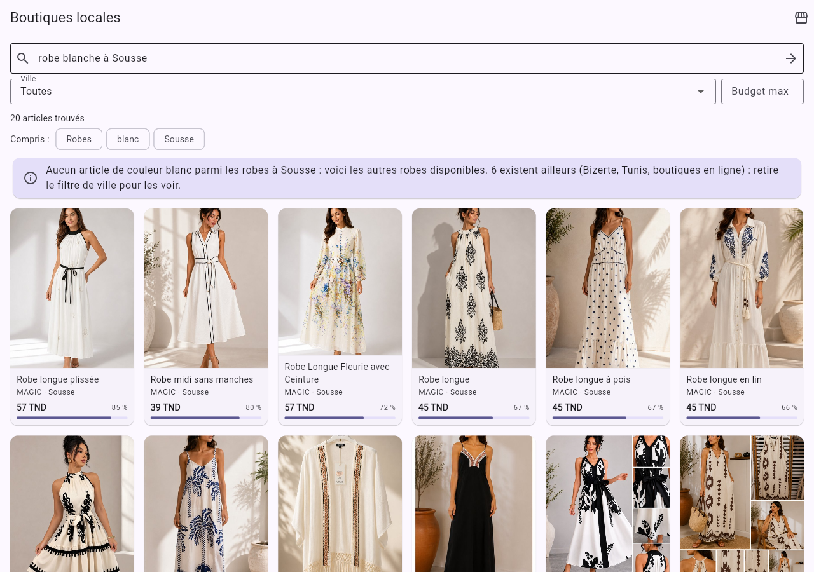

# DressMe — Module M7 "Local catalogue"

**Technical report · BO6 Tunisian market · ESPRIT 2026**
Data collection (scraping), data cleaning, and a search engine for clothes sold by Tunisian shops.

*Updated 14/10/2026: 15 shops, 2,471 products.*

---

## Contents

1. [Context and goal](#1-context-and-goal)
2. [Overview](#2-overview)
3. [Data collection: scraping](#3-data-collection-scraping)
4. [Data cleaning](#4-data-cleaning)
5. [The M7 module](#5-the-m7-module)
6. [How to test the module](#6-how-to-test-the-module)
7. [Limits and next steps](#7-limits-and-next-steps)
8. [Appendix: module files](#8-appendix-module-files)

---

## 1. Context and goal

DressMe is a personal fashion assistant. Module **M7 "Local catalogue"** answers a need specific to the
Tunisian market. A user looks, for example, for *white sneakers in Tunis with a budget of 80 TND*.
Today she has to scroll through dozens of Instagram pages and websites. M7 directly suggests pieces
from Tunisian shops that fit her style, her budget and her city.

Example result returned by the module:

> **Manuella · Tunis · Basket à plateforme femme (platform sneakers) · 69.3 TND · link to the product page**

**Place in the project.** According to the *Task Split* document, M7 is a **shared module**: BO6 builds
it once and other BOs call it (BO1, BO2, BO3, BO5, BO7, BO8, BO9). It must therefore expose a stable
API. The architecture document (*DressMe_MultiAgent_Pipeline.pdf*, section 7 "Local shop agent") sets
the following:

| Item | Architecture requirement | What was built |
|---|---|---|
| Knowledge base | CSV/JSON of shops and pieces, no live scraping | Cleaned CSV of 2,471 products + image index, in `ml/data/shops/` (DVC) |
| Retrieval | Embeddings + BM25 (hybrid) | FashionCLIP (image + text) + BM25 |
| Filters | Price (TND), city, category, style | Price, city/governorate, category, stock, style vector |
| Integration | Tool the orchestrator can call (LangGraph) | `localshop` tool + REST API `/m07/*` + BO6 Flutter screen |
| Input / output | `query, gap, style_vector` → `shop, area, item, price_tnd, match` | Same fields, plus links, photo and reasons |

The additional requirement was to run **FashionCLIP locally in Python**; this is done (§5.2). The choice
was then compared with two newer models on our catalogue (§5.10).

---

## 2. Overview

The work has two parts: an **offline** data preparation (re-run from time to time to refresh prices and
stock), then a very fast **online** search.

```
OFFLINE (preparation)                                        ONLINE (each search, ~40 ms)

 Shop websites                                                "baskets blanches à Tunis 80 TND"
        │  1. scraper/run.py                                            │
        ▼                                                               ▼
 local_catalogue.csv + images/   (2,578 products)               parse    → sneakers · white · Tunis · ≤ 80 TND
        │  2. scraper/clean.py                                          │
        ▼                                                               ▼
 local_catalogue_clean.csv       (2,471 products)               retrieve → FashionCLIP + BM25
        │  3. pipeline/ingest.py                                        │
        ▼                                                               ▼
 index/ (one FashionCLIP vector per photo)  ──────────────────►  filter   → price, city, category, stock
                                                                        │
                                                                        ▼
                                                                 rerank   → score, style, diversity, reasons
```

All the data (CSV, photos, index) lives in `ml/data/shops/`. Like all project data, it is not in git but
shared with DVC (`ml/README.md`).

### 2.1 Input → model → output

Each step takes an input, transforms it with a model or a method, and produces an output that becomes
the input of the next step.

| Step | Input | Model / method | Output |
|---|---|---|---|
| 1. Scraping | A shop's data (e.g. Manuella's Shopify JSON) | Platform adapter + normalisation rules | 1 raw CSV row + 1 JPEG photo |
| 2. Cleaning | Raw row | Rules, *dHash* image fingerprint, HTTP check | 1 clean row (26 columns) |
| 3. Indexing | JPEG photo (800 px) | **FashionCLIP — image encoder** (pre-trained neural network) | Vector of 512 numbers |
| 4. Understanding | The user's sentence (French) | Rules in `parse.py` | Criteria + English sentence |
| 5. Query encoding | English sentence | **FashionCLIP — text encoder** | Vector of 512 numbers |
| 6. Retrieval | Query vector + 2,471 photo vectors + words | Cosine similarity + BM25 | 2 scores per product |
| 7. Filters and ranking | Scores + criteria | Filters, weighted sum, diversity (MMR) | The best k products, with `match` and reasons |

**Only steps 3 and 5 use an artificial-intelligence model (FashionCLIP).** The others are rules and
calculations: fast, free and explainable.

#### A real end-to-end example

The product followed is **Manuella's "Basket à plateforme femme"** (women's platform sneakers); the
request is the one from the project brief.


**Offline — the product enters the catalogue**

**Step 1 · Scraping.** *Input*: the shop's public Shopify product JSON (excerpt).

```json
{"title": "Basket à plateforme femme", "vendor": "Manuella",
 "options": ["couleur", "Pointure"],
 "variants": [{"option1": "Blanc", "option2": "41", "price": "69.300"},
              {"option1": "Blanc", "option2": "40", "price": "69.300"}, "..."]}
```

*Output*: a raw row of `local_catalogue.csv` (and the photo `images/2b7db627f328cf6a.jpg`).

```
Manuella | Basket à plateforme femme | Sneakers | Blanc | 41, 40, 39, 38, 37, 36 | 69.3 TND | Tunis | true
```

**Step 2 · Cleaning.** *Input*: the raw row. *Output*: the clean row (excerpt).

```json
{"product_id": "prd_2b7db627f3", "category": "shoes", "subcategory": "sneakers", "label_fr": "Baskets",
 "color": "white", "color_fr": "Blanc", "color_hex": "#FFFFFF",
 "size": "36, 37, 38, 39, 40, 41", "size_type": "numeric", "price_tnd": 69.3, "currency": "TND",
 "city": "Tunis", "governorate": "Tunis", "product_url_status": "ok", "missing_fields": ""}
```

**Step 3 · Indexing (FashionCLIP).** *Input*: the photo above. *Output*: a vector of 512 numbers that
describes its visual content.

```
[-0.015, 0.046, -0.003, -0.019, -0.045, … 507 more numbers]
```

**Online — the user's search**

API *input* (`POST /m07/search`):

```json
{"query": "baskets blanches à Tunis pour un budget de 80 TND", "k": 3}
```

**Step 4 · Understanding.** *Output*:

```json
{"category": "shoes", "subcategory": "sneakers", "color": "white", "max_price_tnd": 80.0,
 "city": "Tunis", "governorate": "Tunis", "terms": ["basket", "blanche"],
 "prompt_en": "a photo of white sneakers", "corrected": null}
```

**Step 5 · Query encoding (FashionCLIP).** *Input*: `"a photo of white sneakers"`.
*Output*: `[-0.047, 0.004, -0.097, -0.006, 0.003, … 507 more numbers]`.

**Step 6 · Retrieval.** For our sneaker:
- cosine similarity between the query vector and the photo vector: **0.289** (the best score in the
  catalogue is 0.342);
- BM25 score of the words "basket" and "blanche" in its record: **3.91**.

**Step 7 · Filters and ranking.**
- Filters (sneakers, price ≤ 80 TND, Tunis governorate, in stock): **2,471 → 16 products**.
- Score parts for our sneaker:
  - visual = (0.289 − 0.15) / (0.33 − 0.15) = **0.772**;
  - text = **0.974**;
  - attributes (sneakers + white) = **1.0**;
  - no style vector in this request.
- `match` = (0.45 × 0.772 + 0.20 × 0.974 + 0.20 × 1.0) / (0.45 + 0.20 + 0.20) = **0.874**.

API *output* (excerpt, the first 3 results):

| match | Shop | Item | Price | Reasons |
|---:|---|---|---:|---|
| 0.882 | Manuella · Tunis | Basket femme | 62.65 TND | Baskets · Autre couleur : gris · 62.65 TND (budget 80 TND) · Boutique à Tunis · Ressemble visuellement à la demande · Marque tunisienne |
| **0.874** | **Manuella · Tunis** | **Basket à plateforme femme** | **69.3 TND** | Baskets · Couleur : blanc · 69.3 TND (budget 80 TND) · Boutique à Tunis · Ressemble visuellement à la demande · Marque tunisienne |
| 0.761 | Joliesse · Tunis… | Baskets Basses Effet Serpent à Détails Dorés | 79.99 TND | Baskets · Autre couleur : doré · 79.99 TND (budget 80 TND) · Boutique à Tunis · Ressemble visuellement à la demande · Marque tunisienne |

```json
{"shop": "Manuella", "area": "Tunis", "item": "Basket à plateforme femme", "price_tnd": 69.3,
 "match": 0.874, "product_id": "prd_2b7db627f3", "category": "shoes", "subcategory": "sneakers",
 "color": "white", "size": "36, 37, 38, 39, 40, 41", "available": true,
 "image_path": "images/2b7db627f328cf6a.jpg",
 "product_url": "https://manuella.com.tn/products/basket-a-plateforme-femme",
 "reasons": ["Baskets", "Couleur : blanc", "69.3 TND (budget 80 TND)", "Boutique à Tunis",
             "Ressemble visuellement à la demande", "Marque tunisienne"]}
```

---

## 3. Data collection: scraping

### 3.1 Choice of sources

The starting point was a list of **28 sources**: 5 marketplaces or directories (Ad. Mall, Moudda, Lofa,
Hawwini, Boutique.tn), 7 ready-to-wear chains (VOG, HA, Apparel, Celina Fashion, MAGIC, UNJA, Corella)
and 16 shops listed in the Hawwini directory. **9 sources** were added later, mostly for jewellery,
accessories and shoes (Strass Accessoires, HK-STORE, GAŸA, The Queen Accessories, SKILA, Joliesse,
Azar Shoes, Chaussures Pitillos, Shoes Center), for **37 sources** in total.

**Finding the real websites.** For the directory shops, only the brand names were known. Their websites
were found on Hawwini's "retailer" pages (for example NOON → `noonclo.com`, Manuella →
`manuella.com.tn`), then by web search for the additions.
*Why:* guessing domains would have led to wrong sites.

**Sources left out, with the reason** (the list is also in `scraper/shops.py`):

| Source | Reason |
|---|---|
| JENNAH Boutique, Ayada Boutique | **French** shops (prices in euros, addresses in Pantin and Aulnay-sous-Bois) |
| Scarpa Store, Sneakers Tunisie, Sneakers Outlet | Resell **only foreign labels** (Nike, Adidas, Saucony, Givenchy…): nothing left after the "local only" filter |
| Chaussures Pitillos | **Spanish** brand (Arnedo, calzadospitillos.com): not a local label |
| Lofa | Demo catalogue (14 products with stock photos) |
| Celina Fashion, SKILA | Showcase websites: no online catalogue and no prices |
| Dabchy | Second-hand marketplace between individuals, not shops |
| Hawwini | Price comparator: only used to find the websites |
| Shoes Center | `shoescenter.tn` is a parked domain (no shop); `shoescenter.com.tn` has an invalid certificate |
| HK-STORE, GAŸA, The Queen Accessories, Azar Shoes | No website found (in-store or social media sales only) |
| Fripup, MODECO, Spadri, Goat Sneakers | Site down (error 520), unreachable or not found |
| Ad. Mall, boutique.tn, D'Stock | No structured data; would need a dedicated HTML parser (future work) |

**Result: 15 shops in the final catalogue.**

### 3.2 Detecting each site's platform

Before writing any scraping code, each site was analysed to find which e-commerce platform it uses. We
looked at the home page (the `generator` tag and signatures such as `cdn.shopify.com` or `wp-content`)
and tested the known data endpoints of each platform.

| Platform | Shops | Collection method |
|---|---|---|
| **Shopify** | Moudda, NOON, Manuella | Public feed `/products.json` |
| **WooCommerce** | VOG, Corella, Apparel | Public *Store API* `?rest_route=/wc/store/v1/products` |
| **PrestaShop 1.7+** | Exist, FEModest, Shoes Mall, Strass Accessoires, Joliesse | Category pages requested as JSON (`X-Requested-With` header), sizes read on the product page |
| **PrestaShop 1.6** | LYOUM | Parsing the HTML "product cards" (custom theme) |
| **JSON-LD pages** | MAGIC, UNJA | `schema.org/Product` data embedded in every product page |
| **Private API** | HA | JSON API used by their own website (`/api/items/list`) |

*Why this approach:* platforms already publish their products as **structured data** (JSON). This is much
more reliable than extracting text from HTML: price, currency, variants (colours, sizes), stock and
photos come as separate fields. We wrote **one adapter per platform** (`scraper/sources.py`) instead of
one script per site: Strass and Joliesse were added with a few lines of configuration. Only Joliesse's
theme (Creative Elements) needed a change to read shoe sizes.

### 3.3 Scraping that respects the websites

| Rule | Implementation | Reason |
|---|---|---|
| Honour `robots.txt` | Every URL is checked before being requested | Sites state what they allow |
| No overload | At least 0.5 s between two requests to the same site (1 s for URL checks) | Do not disturb the shops |
| Identifiable bot | User-Agent `DressMeCatalogueBot/0.1 (student project, ESPRIT)` | Transparency |
| Temporary errors | Up to 6 retries with growing waits (429, 5xx) | Robustness |
| No cookies | "Stateless" client | See below |

**Problem met: 429 errors on Shopify.** The Shopify shops answered "429 Too Many Requests" although a
single plain request worked. Investigation showed that Shopify blocks the `/products.json` feed **as
soon as its session cookies are present** (set when reading `robots.txt`). Fix: a client that refuses
all cookies, which sites do not need to show a public catalogue.

### 3.4 Normalisation during collection

Every shop describes its products in its own way. To get a consistent catalogue, keyword rules are
applied (`scraper/normalize.py`):

- **Category** from the product name, then the shop's own category. The rules cover French, English,
  Tunisian words and Arabic: *dengri* (jeans), *pul* (sweater), *joking* (jogging), *jebba*, *jelbeb*,
  *كسوة*, *جلباب*… **Rule order matters**: "veste en jean" (denim jacket) must be a jacket, "short en
  jean" shorts, "chaussettes pour sneakers" or "portefeuille jean" (denim wallet) an accessory, and
  "short basket" basketball shorts, not sneakers.
- **Main colour**: the colour named in the product name, otherwise the first colour variant. Codes such
  as `T00849-NOIRDEL` are recognised too. The word "jean" only means blue as a last resort, because a
  "Jean" sold in variant NOIR is black.
- **Sizes**: only sizes **in stock** when the shop publishes stock per size.
- **Price**: only prices **in TND** are kept (the currency is checked for every platform).
- **City**: checked on the website (contact page, "our stores" page, Shopify shop data), for example
  VOG → Bizerte, LYOUM → La Marsa, UNJA → Sfax, MAGIC → 9 cities, Joliesse → 10 cities (20 stores),
  Strass → 7 cities (13 stores). **Left empty** when the site gives no address.

### 3.5 Filters applied during collection

| Filter | Examples removed | Reason |
|---|---|---|
| Not fashion | Books and prayer beads (FEModest), suitcases (Joliesse), cushions | Not clothes |
| Children / babies | "Sandale fillette", "Sortie naissance", "Baskets Garçonnet" | DressMe works on adult wardrobes |
| **Foreign labels** | Nike, Adidas, UGG, Saucony, Moncler… and model names (Air Force, Samba…) | BO6 goal: promote **local** brands and shops |
| No price or no photo | Photos that could not be downloaded | A product without a photo cannot be shown or embedded |

The foreign-label filter runs **before** the per-shop quota. *Why:* otherwise a shop like Moudda would
have lost part of its 300 slots instead of filling them with local pieces.

**Catalogue balance.** At most **300 products per shop** are kept, picked in turn from each category.
*Why:* otherwise a big shop would fill the catalogue with a single product type.

### 3.6 Product photos

One photo per product is downloaded into `ml/data/shops/images/`, converted to a JPEG of at most 800 px
(**2,578 photos, 94 MB**). The file name is derived from the product URL, so it stays the same from one
update to the next, and a photo already on disk is not downloaded again.
*Why:* FashionCLIP needs the images locally, and the app shows them without depending on the shops'
websites (route `/m07/images/…`).

### 3.7 Scraping results

| Shop | Products read | Kept | Main exclusions |
|---|---:|---:|---|
| Moudda | 1,250 | 300 | 272 foreign labels, 71 children |
| Manuella | 700 | 300 | 73 children |
| VOG | 1,200 | 300 | — |
| Exist | 1,163 | 300 | 12 not fashion |
| HA | 791 | 300 | 29 children |
| **Strass Accessoires** | 825 | 300 | 30 not fashion, 9 children |
| **Joliesse** | 357 | 300 | 18 not fashion (suitcases), 20 children |
| MAGIC | 94 | 92 | 2 children |
| NOON Clothing | 90 | 90 | — |
| LYOUM | 115 | 80 | 33 not fashion (home, beach towels) |
| Apparel | 83 | 51 | 17 not fashion, 12 children |
| Corella Store | 56 | 48 | 6 children |
| UNJA | 36 | 36 | — |
| FEModest | 97 | 27 | 70 not fashion (books, prayer beads) |
| Shoes Mall | 10 | 9 | — |
| Scarpa, Sneakers Tunisie, Sneakers Outlet | 739 | 47 | 687 foreign labels (the 47 left too, removed at cleaning) |
| **Total** | | **2,578 with a photo** | |

### 3.8 Adding or refreshing shops

The `--merge` option scrapes only the requested shops and keeps the others as they are, with their
photos:

```bash
python -m modules.m07_local_catalogue.scraper.run --shops strass joliesse --merge
```

*Why:* adding Strass and Joliesse only required those two shops (about 15 minutes) instead of
re-scraping the other 13.

---

## 4. Data cleaning

The script `scraper/clean.py` turns `local_catalogue.csv` (2,578 products) into
`local_catalogue_clean.csv` (**2,471 products**). Every step is counted in
`ml/data/shops/cleaning_report.md`. The category rules are applied again to each product name, so a rule
fix improves the catalogue without re-scraping.

### 4.1 Prices as numbers, checked in TND

All prices are decimal numbers, strictly positive. The currency is guaranteed at the source: the
adapters only keep TND prices (Shopify shop currency, WooCommerce `currency_code`, JSON-LD
`priceCurrency`). A `currency = TND` column is added.
Prices far from the median of their subcategory (below one fifth or above five times) are **flagged** in
`quality_flags` (20 very low, 5 very high) but **never changed**.
*Why:* an unusual price is not necessarily wrong (a 0.5 TND hijab pin is real).

### 4.2 Last "local only" check

Cleaning applies the foreign-label filter again, with an extended list of model names sold without the
brand in the title ("AIR FORCE 1 '07", "BASKET BOY AIR-FORCES", "On Cloudtilt"…). **58 products
removed**, plus 3 children's pieces and 1 suitcase.

### 4.3 Common category nomenclature

Categories follow the project's **shared data contract** (`GarmentCategory`: `top`, `bottom`, `dress`,
`outerwear`, `shoes`, `accessory`, `traditional`), with a precise **subcategory** and a **French label**
for display:

| Before (shop wording) | `category` | `subcategory` | `label_fr` |
|---|---|---|---|
| sneakers, baskets, basket, Samba… | shoes | sneakers | Baskets |
| chaussures, mocassins, derbies | shoes | shoes | Chaussures |
| costume, tailleur, smoking (suit) | dress | suit | Costumes |
| collier, pendentif, chaîne (necklace) | accessory | necklace | Colliers |
| bracelet, gourmette | accessory | bracelet | Bracelets |
| bague, alliance (ring) | accessory | ring | Bagues |
| boucles / puces d'oreilles (earrings) | accessory | earrings | Boucles d'oreilles |
| jebba, kaftan, جلباب | traditional | traditional | Tenues traditionnelles |

*Why:* the Vision module (M1) classifies the wardrobe with the same categories, so M7 and M1 "speak the
same language". Jewellery is split by type so that a "bracelet" search does not return rings.
Final split: shoes 688, accessories 673, tops 408, bottoms 353, dresses/sets/suits 205, jackets/coats 131,
traditional outfits 13.

### 4.4 Colours, sizes and cities made consistent

- **Colours**: an English code (`white`, `navy`…) identical to the Vision module's, plus the French name
  (`Blanc`) and a hex code (`#FFFFFF`).
- **Sizes**: one notation, sorted. `2XL` becomes `XXL`, `ST` becomes `Taille unique` (one size), and
  sizes are in order (`S, M, L, XL`, `38, 39, 40`). A `size_type` column gives the system (`letter`,
  `numeric`, `one_size`, `bra`…). We started from **94 different notations**.
- **Cities**: official name (`Béja`, `La Marsa`) and **governorate** (`La Marsa` → `Tunis`).
  *Why:* a user searching "in Tunis" must also see the shops in La Marsa.

### 4.5 Removing duplicates

Comparing only name and price would have been a mistake: different products often share a generic name
("Basket Homme" at 59.5 TND exists in 4 colours with 4 different photos). Two products are therefore
duplicates when they have **the same name, the same price and an almost identical photo**, compared with
a **perceptual fingerprint** (64-bit *dHash*). The copy kept is the one in stock with the most sizes.
**45 duplicates removed**: 13 within one shop and 32 across two shops (for example Corella and Apparel
sell the same items at the same price).

### 4.6 URL checks

Every product page URL and every photo URL was checked with an HTTP request (**4,944 URLs**).
- A page that returns 404/410, or redirects to the home page, is **dead**: the product is removed.
- Other failures are **flagged** without removing the product.
- Results are cached (`url_checks.json`), so a re-run only checks new URLs.

On the first pass, 625 Shopify pages answered "429" (rate limit). That is not a dead page, so they were
checked again more slowly (1 request/s, honouring the `Retry-After` header).
**Result: 4,944 of 4,944 URLs answer correctly (200); no dead product.**

### 4.7 Missing information marked, never invented

A missing value stays **empty** and the field name is listed in the `missing_fields` column. No value is
guessed.

| Field | Filled | Why it is sometimes missing |
|---|---:|---|
| Colour | 85.6 % | No colour in the name and no colour variant (jewellery, accessories…) |
| Size | 62.1 % | Accessories and jewellery (no size), or the shop does not publish sizes |
| City | 68.6 % | Online shops with no published address (NOON, Exist, HA…) |

*Why:* an invented colour or city could send the user to a shop that does not have the piece. The search
engine handles these gaps (§5.5) and says so ("Couleur non précisée par la boutique", "Ville non
précisée", i.e. not given by the shop).

### 4.8 Stable identifiers

Each product gets an id `prd_` + a fingerprint of its URL (for example `prd_2b7db627f3`).
*Why:* the P0001… numbering changes with every scrape, whereas other modules (favourites, M13 partner
links, M10 sharing) need a durable reference.

### 4.9 Final catalogue

| Indicator | Value |
|---|---|
| Products | **2,471** |
| Shops | **15** |
| Tunisian brands / local multi-brand shops | 2,153 / 318 |
| In stock | 2,060 |
| Median price | 69.9 TND (from 0.5 to 399.99 TND) |
| Jewellery | 38 necklaces, 27 rings, 12 bracelets, 10 pairs of earrings |

| Shop | Products | Shop | Products | Shop | Products |
|---|---:|---|---:|---|---:|
| Manuella | 300 | Moudda | 282 | Corella Store | 48 |
| HA | 299 | MAGIC | 90 | UNJA | 36 |
| Joliesse | 299 | NOON Clothing | 90 | FEModest | 27 |
| Strass Accessoires | 299 | LYOUM | 80 | Apparel | 18 |
| VOG | 299 | Exist | 295 | Shoes Mall | 9 |

---

## 5. The M7 module

### 5.0 M7 input → model → output

§2.1 follows the whole path, from scraping to search. Here we only look at **the M7 module itself**,
that is what happens on each call to `POST /m07/search` (or to the `localshop` tool): the catalogue and the
index are already built.

```
INPUT (JSON)                       M7 MODEL (agent.py, ~40 ms)                          OUTPUT (JSON)

{"query": "robe blanche",     ┌──────────────────────────────────────────────┐     {"results": [
 "city": "Sousse",            │ 1. parse      FR/EN/Tunisian/Arabic rules    │       {"shop", "area", "item",
 "max_price_tnd": …,          │               → criteria + English prompt    │        "price_tnd", "match",
 "gap": …,                    │ 2. encode     FashionCLIP (text → 512 nums)  │        "image_path",
 "style_vector": …,     ───►  │ 3. retrieve   cosine with 2,471 photos       │ ───►   "product_url",
 "image_embedding": …,        │               + BM25 on the words            │        "reasons", …}, …],
 "k": 3}                      │ 4. filter     price, city, type, stock       │      "parsed": {criteria},
                              │ 5. rerank     weighted score, style, MMR,    │      "total_matches": 20,
                              │               reasons                        │      "note": "…"}
                              └──────────────────────────────────────────────┘
```

| Part | What it receives | What it does | What it produces |
|---|---|---|---|
| **Input** | A sentence (`query`), a wardrobe gap (`gap`), explicit filters (`city`, `max_price_tnd`, `subcategory`, `color`…), optionally a style vector (M5) or an image vector (M1) | Pydantic validation (`LocalShopInput`): at least one search criterion | A valid request, otherwise error 422 |
| **Model** | The request + the catalogue + the index | Rules (understanding, filters) + **FashionCLIP** (the only learned part) + BM25 + weighted score | The ranked products |
| **Output** | The k best products | `LocalShopOutput` | `results` (shop, city, item, price, `match`, photo, link, reasons), `parsed` (what was understood), `total_matches`, `note` |

#### Real examples (current catalogue, 15 shops)

Each row is a real API answer, with `k = 3` (the first 3 results).

| Input sent to M7 | What M7 understood (`parsed`) | Output (`total_matches` then results) |
|---|---|---|
| `{"query": "baskets blanches à Tunis pour un budget de 80 TND"}` | sneakers · white · Tunis · ≤ 80 TND; prompt "a photo of white sneakers" | **16** — Manuella · Tunis · Basket femme · 62.65 TND (0.882); Manuella · Tunis · Basket à plateforme femme · 69.3 TND (0.874); Joliesse · Tunis · Baskets Basses Effet Serpent · 79.99 TND (0.761) |
| `{"query": "robe blanche", "city": "Sousse"}` (white dress) | dress · white · Sousse | **20** — MAGIC · Sousse · Robe longue plissée · 57 TND (0.853); Robe midi sans manches · 39 TND (0.803); Robe Longue Fleurie · 57 TND (0.715). *note*: "Aucun article de couleur blanc parmi les robes à Sousse : voici les autres robes disponibles. 6 existent ailleurs (Bizerte, Tunis, boutiques en ligne) : retire le filtre de ville pour les voir." (no white dress in Sousse, 6 elsewhere) |
| `{"query": "colier"}` (typo) | necklace; `corrected` = "collier" | **37** — Strass · Collier avec Pendentifs Trèfles · 22.9 TND (0.944); Collier avec Étoile de Mer · 39.9 TND (0.94); Collier Sautoir · 79.9 TND (0.93) |
| `{"gap": "white shirt", "city": "Tunis"}` (Smart Buy) | shirt · white · Tunis | **13** — Moudda · Chemise Satin · 69.9 TND (0.771); MAGIC · Chemise brodée · 50 TND (0.696); CHEMISE W RRAYE · 59.99 TND (0.619). *note*: no white shirt in Tunis, 11 elsewhere (Bizerte, online shops) |
| `{"subcategory": "bag", "color": "camel", "max_price_tnd": 150}` (fields only, no sentence) | bag · camel · ≤ 150 TND; prompt "a photo of camel handbag" | **343** — Manuella · Sac à main minimaliste · 129 TND (0.955); Joliesse · Sac à Main Structuré · 139.99 TND (0.923); Manuella · Sac pochette · 69.3 TND (0.9) |
| `{"query": "zorglub"}` (unknown word) | nothing | **0** — *note*: "Je n'ai trouvé aucun article correspondant à « zorglub » dans les boutiques locales." (no matching item) |
| `{"city": "Tunis"}` (nothing to search) | — | Error **422**: the input is rejected before the model |

**Key points.**
- **Colour** is a soft criterion: if no piece of the right colour exists in the requested city, M7 shows
  the other pieces of the right type **and says so** in `note`, instead of inventing or returning an empty
  page.
- The `area` field gives **the city of the store that matches the filter**. For a chain present in
  several cities (MAGIC: Tunis, Sousse, Sfax…), a search in Sousse shows "MAGIC · Sousse".
- `match` (0 to 1) and `reasons` are computed only from the data and the scores.



### 5.1 Architecture and contract

The module follows the structure of the shared modules (`backend/modules/m07_local_catalogue/` with
`contract.py`, `router.py`, `service.py`, `mock.py`, `tool.py`, `tests/`), plus `agent.py` and `pipeline/`,
and the pipeline set by the architecture: **parse → retrieve → filter → rerank**.

**Input** (`LocalShopInput`) — at least one of `query`, `gap`, `category`/`subcategory` or
`image_embedding`:

| Field | Example | Used by |
|---|---|---|
| `query` | "baskets blanches à Tunis pour 80 TND" | Chat (BO8), search screens |
| `gap` | "white shirt" | Smart Buy (BO5), wardrobe analysis |
| `city`, `max_price_tnd`, `min_price_tnd` | "Tunis", 80 | Explicit filters |
| `category`, `subcategory`, `color` | shoes, sneakers, white | Explicit filters |
| `user_id`, `style_vector` | "usr_042", "vec_u042" (or 512 numbers) | Style profile (M5): the id is resolved through M5, as in the architecture |
| `image_embedding` | 512 numbers | Photo of a piece (Vision M1 / Smart Buy) |
| `include_unavailable`, `k` | false, 10 | Options |

Explicit fields take priority over what is read in the text, and the FashionCLIP prompt is rebuilt from
the final criteria.

**Output** (`LocalShopOutput`): the `results` list keeps the fields set by the architecture (`shop`,
`area`, `item`, `price_tnd`, `match`), with the id, links, photo, sizes, stock and **reasons**. It also
has `parsed` (the filters actually applied and the corrected request), `total_matches` and `note` (city
relaxed, sold-out items, nothing found…).

### 5.2 FashionCLIP index (knowledge base)

**FashionCLIP** (`patrickjohncyh/fashion-clip`) is an artificial-intelligence model: a neural network
(CLIP architecture) trained by researchers on about 800,000 fashion photos with their descriptions. It
turns **a photo into a list of 512 numbers** (a "vector") and **an English sentence into another list of
512 numbers**, so that a photo and its right description get close vectors: *"a photo of white dress"* is
close to photos of white dresses. We did not retrain it: it is used as is (*zero-shot*).

*Why FashionCLIP:*
- it understands **visual content** (shape, colour, pattern) even when the shop's description is poor or
  wrong;
- the architecture recommends it for the Vision module, so M7, M1 (wardrobe) and M5 (style vector) share
  the same space;
- it runs **locally** on CPU, with no paid service.

The script `pipeline/ingest.py` encodes every catalogue photo (`ml/data/shops/index/`, 512 numbers per
photo). The first build took **3 min 42 s for 1,874 photos** on CPU. The index is **incremental**: when
Strass and Joliesse were added, only the **599 new photos** were encoded, in **35 s**. The model
(581 MB) is downloaded on first run, or read from `ml/models/fashion-clip/` if present (DVC).

### 5.3 Understanding the request (`pipeline/parse.py`)

The user's sentence is turned into criteria:

```
"Je cherche une chemise en lin blanche moins de 100 dt à la Marsa"
(I'm looking for a white linen shirt under 100 dt in La Marsa)
  → subcategory: shirt · color: white · max_price_tnd: 100 · city: La Marsa (Tunis governorate)
  → FashionCLIP prompt: "a photo of white linen shirt"
```

It recognises budgets ("moins de 80 dt", "entre 50 et 120 dinars"), Tunisian cities, colours, categories
and attributes (lin → linen, cuir → leather, fleuri → floral…).

**Typo correction.** An unknown word that is very close to a known one is corrected ("colier" →
"collier"). The reference vocabulary combines the rule keywords and the words actually used by the
shops. The app shows "Recherche corrigée : « collier »".

*Why a rule-based parser rather than an LLM:* it uses **exactly the same word lists** as the cleaning step
("baskets" in a query and in a product always map to the same subcategory), and it is instant, free,
deterministic and testable.

*Why an English prompt:* FashionCLIP was only trained on English (§5.10). The French request is rewritten
in English from the understood criteria. **Other languages (French, Tunisian, Arabic) are therefore
handled by our rules, not by FashionCLIP.**

### 5.4 Hybrid retrieval (`pipeline/retrieve.py`)

Two scores are computed for **every** product:
- **Visual (FashionCLIP)**: cosine similarity between the prompt (or the photo sent) and the product
  photo;
- **Text (BM25)**: a classic keyword search algorithm (statistics, no learning) on the name, category,
  colour, shop and city.

*Why hybrid:* the visual score finds pieces even when they are badly described; the text score catches
precise words (a shop name, "jebba") that the image does not contain.
*Why exact scoring:* with ~2,500 products, comparing against every product takes a few milliseconds; a
vector database (pgvector, Qdrant) only pays off at a larger scale.

### 5.5 Filters (`pipeline/filter.py`)

| Filter | Type | Reason |
|---|---|---|
| Price ≤ budget, price ≥ minimum | Hard | The TND budget is a user constraint |
| City **or its governorate** | Hard | "Tunis" includes La Marsa; a shop with no address is not placed in a random city |
| Category / subcategory | Hard | A request for sneakers must not return sandals |
| In stock | Hard (can be disabled) | Do not suggest what cannot be bought |
| Colour | **Soft** (in the score) | 14 % of products have no known colour; a hard filter would wrongly drop them |

Three safeguards complete these filters:
- **Nothing understood** (no type, colour or photo): only products containing the searched words are
  kept, otherwise the engine answers "Je n'ai trouvé aucun article correspondant à …" (no matching item).
  It no longer fills the list with unrelated pieces.
- **City with no result**: the city filter is relaxed and `note` says so.
- **Nothing in stock**: sold-out items are shown with a "Rupture de stock" (sold out) label rather than
  an empty page.

### 5.6 Score, style, diversity and explanations (`pipeline/rerank.py`)

The `match` score (between 0 and 1) is a weighted mean of the parts that apply:

| Part | Weight | Measure |
|---|---:|---|
| Visual | 0.45 | FashionCLIP query ↔ photo, mapped to 0–1 |
| Text | 0.20 | BM25, relative to the best candidate |
| Attributes | 0.20 | Requested subcategory; colour: same = 1, unknown = 0.5, other = 0 |
| Style | 0.15 | User's style vector ↔ product photo |

Weights are **renormalised** over the parts available.

**Calibration.** FashionCLIP similarities are low in absolute value, so their distribution was measured on
the real catalogue: text → photo (median ≈ 0.11, 99th percentile ≈ 0.30), hence the range [0.15, 0.33];
photo → photo (median ≈ 0.42, 99th percentile ≈ 0.66), hence the range [0.40, 0.85].

**Diversity (MMR).** The module avoids returning 5 almost identical photos (the same model in 5 colours).

**Explanations without invention.** Each result has reasons built only from the data and the scores:
"Baskets", "Couleur : blanc", "69.3 TND (budget 80 TND)", "Boutique à Tunis (près de La Marsa)",
"Ressemble visuellement à la demande", "Marque tunisienne". They are in French because the app is in
French. They feed the "why this local piece" screen (BO6) and the LLM module (M8) without letting a
model invent facts.

### 5.7 Integration in the project

- **Orchestrator tool**: `tool.py` exposes the agent as `localshop`; `orchestrator/registry.py` picks it up
  automatically.
- **REST API** (`router.py`, included automatically by `api/main.py` under the `/m07` prefix):
  - `POST /m07/search`: search;
  - `GET /m07/shops`: list of shops;
  - `GET /m07/products/{product_id}`: one product;
  - `GET /m07/images/{name}`: local copy of a product photo.
- **Without the data** on the machine (clone without `dvc pull`), the service answers with `mock.py`
  instead of failing, so the modules that call M7 are never blocked.
- **BO6 screen** (`mobile/lib/features/bo6_local_market/`): search, city and budget filters, understood
  criteria, photo grid, product sheet, list of shops (§6.4).
- The model is loaded at the first search (about 12 s), then **each search takes about 40 ms**.

### 5.8 Real examples

**"baskets blanches à Tunis pour un budget de 80 TND"** → 16 products (Manuella and Joliesse):

| match | Shop | City | Item | Price |
|---:|---|---|---|---:|
| 0.88 | Manuella | Tunis | Basket femme | 62.65 TND |
| 0.87 | Manuella | Tunis | Basket à plateforme femme | 69.3 TND |
| 0.76 | Joliesse | Tunis | Baskets Basses Effet Serpent à Détails Dorés | 79.99 TND |

The first product is labelled "grey" by the shop, but its photo shows a cream/white sneaker: FashionCLIP
ranks it high, and the reason shown still reports the shop's label.

| Query | Result |
|---|---|
| "une robe blanche" (a white dress) | 78 dresses, white ones first (HA 41.99 TND, Moudda 45.43 TND…) |
| "collier doré" (gold necklace) | 37 necklaces, mostly Strass Accessoires (34.9 – 39.9 TND) |
| "bracelet" | 12 bracelets (Strass, Exist) |
| "sandales à Sfax" | 97 sandals, Joliesse first (2 stores in Sfax) |
| "costume" (suit) | 6 full suits (Exist, 249.99 – 399.99 TND) |
| "jebba brodée" | 13 traditional outfits (UNJA, Corella, FEModest) |

### 5.9 Fixes after the first tests in the app

Testing in the app revealed three problems, all in request understanding (not in FashionCLIP):

| Query | Before | Cause | After |
|---|---|---|---|
| "costume" (suit) | Suits, then bracelets, caps, sweaters | Unknown word + the list was always filled, even with unrelated items | 6 suits only |
| "colier" (typo) | Random list | No typo tolerance | Corrected to "collier": 37 necklaces |
| "bracelet" | 1 bracelet + 4 rings | All jewellery in one category | 12 bracelets only |

Fixes: suit vocabulary, jewellery split by type, typo correction, "nothing understood" safeguard,
sold-out items shown with a label. Each case has an automated test.

A second round of feedback was about the **city filter** and the display:

| Problem reported | Cause | Fix |
|---|---|---|
| "robe blanche" + city Sousse showed "MAGIC · Tunis": the filter seemed broken | The filter worked (only Sousse stores were kept), but the card showed the chain's **first** city (Tunis); and there is no white dress in Sousse | `area` now only holds the cities matching the filter ("MAGIC · Sousse"); without a filter, the card shows "Tunis +8"; `note` explains that there is no white dress in Sousse and where there are some |
| "DEBUG" ribbon at the top right | Shown by default by Flutter in development mode | `debugShowCheckedModeBanner: false` in `mobile/lib/main.dart` |

### 5.10 Is FashionCLIP the best choice?

**Comparison on our catalogue.** Three fashion models were evaluated on the 1,873 photos of the time,
with the shops' labels as the reference (105 "colour + type" searches):

| Measure | **FashionCLIP** (kept) | Marqo-FashionSigLIP | Marqo-FashionCLIP |
|---|---:|---:|---:|
| "Colour + type" search: right items in the top 10 | 29.7 % | **32.5 %** | 30.9 % |
| Type search: right items in the top 10 | 67.6 % | 68.9 % | **69.4 %** |
| Type recognised from the photo | 66.8 % | **72.0 %** | 67.3 % |
| Colour recognised from the photo | 47.9 % | 47.5 % | **48.9 %** |
| CPU speed | **96 ms/photo** | 234 ms/photo | 236 ms/photo |
| Vector size | **512** | 768 | **512** |

**Decision: keep FashionCLIP for now.** The newer models gain only 1 to 3 points on search (close to
measurement noise, with imperfect labels); in M7 the visual part only weighs 45 % of the score and the
filters guarantee the essentials; FashionCLIP is 2.4× faster and keeps the project's 512 convention.
Marqo-FashionSigLIP (768) would require changing M1 and M5 too: that is a team decision.

**Languages.** FashionCLIP only really understands English. On 12 queries sent directly to the model,
the right type appears in the top 10 for 77 % of English queries ("black skirt") against 58 % of French
ones ("jupe noire": 0 %). This is why French, Tunisian and Arabic go through our rules, which rewrite the
request in English.

**Should the model be fine-tuned?** Not first: the errors observed came from request understanding.
Recommended order: (1) a test set of 50 to 100 real annotated queries to measure progress; (2) request
understanding by M8's LLM for unusual sentences; (3) M1's cut-out photos; (4) only then a light
fine-tuning (last layers or LoRA, on a Colab GPU) with our photo + French name pairs and labelled Tunisian
data, sharing the resulting model with M1 and M5.

---

## 6. How to test the module

Backend commands run from `backend/`, app commands from `mobile/`.

### 6.1 Automated tests (no model and no internet needed)

```bash
cd backend
pip install -r requirements-dev.txt
pytest modules/m07_local_catalogue -q     # expected: 54 passed
pytest -q                                 # whole backend: 79 passed
```

These tests use a tiny catalogue and a fake encoder, so they need neither `torch`, nor the model, nor the
data.

| File | What is checked |
|---|---|
| `test_contract.py` | Input validation, light agent at creation |
| `test_mock.py` | The fixed answer of `mock.py` follows the contract |
| `test_router.py` | `/m07/*` routes, mock fallback without data, protected photos, style vector resolved through M5 |
| `test_search.py` | The "white sneakers in Tunis 80 TND" example, governorate, city relaxation, explicit fields, unknown colour not guessed, style and photo, typos, jewellery and suits, unknown words, sold-out items, city shown according to the filter and missing-colour note |
| `test_ingest.py` | Incremental index: only new photos are encoded |
| `test_clean.py` | Sizes, duplicates, URL status, common nomenclature, cities |
| `test_scraper_normalize.py` | Categories (FR/EN/Tunisian/Arabic), colours, sizes, brands, balancing |

Front end: `cd mobile && flutter test` → **4 tests**.

### 6.2 Requirements for a real search

```bash
pip install -r modules/m07_local_catalogue/requirements.txt   # torch, transformers, requests, pillow...
```

The module data lives in `ml/data/shops/` and is shared with DVC (`dvc pull`). Without DVC, rebuild it:

```bash
python -m modules.m07_local_catalogue.scraper.run      # 1. scraping + photos     (~30 min)
python -m modules.m07_local_catalogue.scraper.clean    # 2. cleaning + URL checks (~15 min the first time)
python -m modules.m07_local_catalogue.pipeline.ingest  # 3. FashionCLIP index     (~5 min the first time, then incremental)
```

### 6.3 Testing through the API (Swagger)

```bash
cd backend
uvicorn api.main:app --port 8010
```

Open **http://127.0.0.1:8010/docs**, choose `POST /m07/search`, **Try it out**, paste a JSON body (see the
table in §6.4), **Execute**. Port 8000 is already used by another application on the development
machine; any free port works.

### 6.4 Testing in the app (Flutter front end)

The BO6 "Boutiques locales" screen (`mobile/lib/features/bo6_local_market/`) calls M7 through the API, as
the final app will.

| Home | Results |
|---|---|
|  |  |
| **Product sheet** | **Shops** |
|  |  |

1. **Start the API** (terminal 1): `cd backend` then `uvicorn api.main:app --port 8010`
2. **Start the app** (terminal 2):
   ```powershell
   $env:Path += ";C:\Users\Kinza\flutter\bin"
   cd mobile
   flutter pub get
   flutter create . --platforms=web     # once: generates web/ (do not commit it, M6 generates the platforms)
   flutter run -d web-server --web-port 8081 --dart-define=API_URL=http://localhost:8010
   ```
3. **Open Chrome** on the BO6 screen (terminal 3):
   ```powershell
   & "C:\Program Files\Google\Chrome\Application\chrome.exe" --disable-web-security --user-data-dir="$env:TEMP\chrome-dressme-test" "http://localhost:8081/#/bo6_local_market"
   ```
4. Type a request (or click an example), then tap a piece to open its sheet.

| Action | Expected result |
|---|---|
| "baskets blanches à Tunis pour 80 TND" | 16 sneakers (Manuella, Joliesse) ≤ 80 TND; "Compris : Baskets · blanc · ≤ 80 TND · Tunis" |
| "une robe blanche" | 78 dresses, 24 shown, white ones first, with shop, city and price |
| "robe blanche" + Ville: Sousse | 20 dresses "MAGIC · Sousse" and the note "Aucun article de couleur blanc parmi les robes à Sousse… 6 existent ailleurs" |
| "colier" (with the typo) | "Recherche corrigée : « collier »", 37 necklaces |
| "bracelet" / "costume" | 12 bracelets / 6 suits, no other item type |
| `{"subcategory": "bag", "color": "camel", "max_price_tnd": 150}` (API) | Bags, camel first |
| `{"gap": "white shirt", "city": "Tunis"}` (API) | Shirts from shops in Tunis, ranked by likeness to a white shirt |
| Tap a piece | Photo, price, match, sizes, reasons, product page link to copy |
| Shop icon (top right) | The 15 shops with their cities and website |
| `{"city": "Tunis"}` (API) | Error **422** (nothing to search) |

**Watch out:**
- **Do not use your usual Chrome**: the page loads, but searches fail ("Serveur injoignable", server
  unreachable) because the browser blocks calls to another port (CORS rule) and the API has no CORS
  configuration yet (`api/main.py`, the lead's file). The `--disable-web-security` flag, for local testing
  only, lifts the block. On a phone or emulator it is not needed:
  `flutter run --dart-define=API_URL=http://<PC-IP>:8010`.
- **Avoid port 5060** for the app: Chrome refuses it (`ERR_UNSAFE_PORT`, a port reserved for SIP
  telephony).

### 6.5 Testing directly in Python

```python
import asyncio
from modules.m07_local_catalogue.agent import LocalShopAgent

agent = LocalShopAgent()
out = asyncio.run(agent({"query": "baskets blanches à Tunis pour un budget de 80 TND", "k": 5}))
print(out["parsed"])              # understood criteria
for r in out["results"]:
    print(r["match"], r["shop"], r["area"], r["item"], r["price_tnd"], r["reasons"])
```

### 6.6 Checking the data

- Open `ml/data/shops/local_catalogue_clean.csv` in Excel (UTF-8 encoding).
- Read `ml/data/shops/cleaning_report.md` for the detail of each cleaning step.
- Filter the `quality_flags` column to see the prices to review.

---

## 7. Limits and next steps

| Limit | Next step |
|---|---|
| 31 % of products have no city (online shops with no address) | Contact the shops; add a "delivers everywhere" notion |
| Shops without a website (HK-STORE, GAŸA, The Queen Accessories, Azar Shoes…) | A partner file (CSV) filled by hand or by the shop, as the architecture plans |
| Words outside the vocabulary are not understood (the engine says so instead of inventing) | Request understanding by M8's LLM for unusual sentences |
| FashionCLIP only understands English | Current rules; test a multilingual model (jina-clip-v2) with the comparison script |
| No evaluation on real annotated queries yet | Build 50 to 100 annotated queries and measure in `ml/notebooks/localcatalogue/` |
| Photo search influenced by the photo style (same studio) | Pass `subcategory`; use M1's cut-out image |
| Style vector range not calibrated (no M5 profiles yet) | Recalibrate when M5 provides real vectors |
| Ad. Mall, boutique.tn, D'Stock not covered | Write dedicated HTML parsers |
| Data frozen between two scrapes | Schedule the refresh (Celery beat, M4) with `--merge` |

---

## 8. Appendix: module files

```
backend/modules/m07_local_catalogue/
├── agent.py            M7 agent: parse → retrieve → filter → rerank
├── contract.py         input / output (Pydantic)
├── taxonomy.py         shared vocabulary: categories, jewellery, colours, cities and governorates
├── config.yaml         model, score weights, calibration ranges, data location
├── paths.py            where the data (ml/data/shops) and the model live
├── clients.py          calls to other modules (M5: style vector)
├── router.py           /m07/* routes (included automatically by api/main.py)
├── service.py          real implementation shared by the API and the tool
├── mock.py             fixed answer in the same shape, for other modules' tests
├── tool.py             tool for the orchestrator (picked up automatically)
├── pipeline/
│   ├── parse.py        request understanding + typo correction
│   ├── retrieve.py     FashionCLIP + BM25
│   ├── filter.py       price, city, category, stock
│   ├── rerank.py       score, style, diversity, reasons
│   ├── encoder.py      local FashionCLIP
│   ├── catalogue.py    loads the knowledge base + index + vocabulary
│   └── ingest.py       incremental index build (offline)
├── scraper/
│   ├── shops.py        shops kept and left out (with reasons)
│   ├── sources.py      one adapter per platform
│   ├── client.py       polite HTTP client (robots.txt, delays, no cookies)
│   ├── normalize.py    rules for categories, colours, sizes, brands, children
│   ├── images.py       photo download
│   ├── run.py          runs the scraping (--shops, --merge)
│   └── clean.py        cleaning + URL checks
└── tests/              53 tests
ml/data/shops/          module data (DVC, not git)
├── local_catalogue.csv / .xlsx   raw scraped data
├── local_catalogue_clean.csv     cleaned knowledge base
├── cleaning_report.md            cleaning summary
└── images/  index/  url_checks.json
mobile/lib/features/bo6_local_market/   BO6 "Boutiques locales" screen (Flutter)
mobile/test/bo6_local_market_test.dart  screen tests
```
